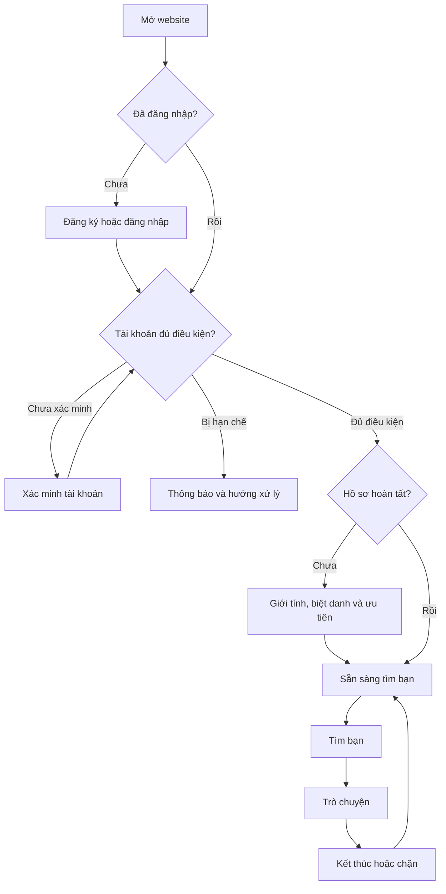
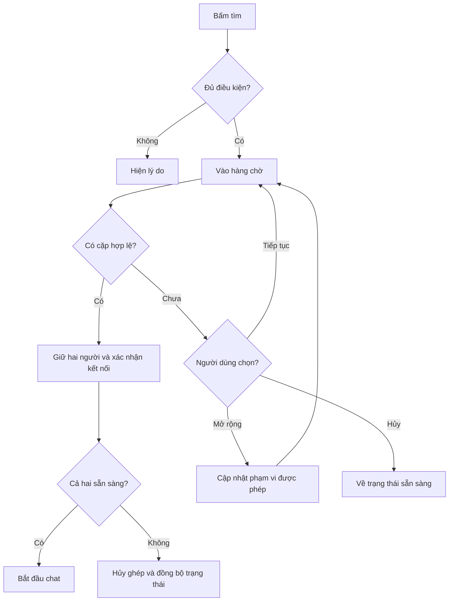
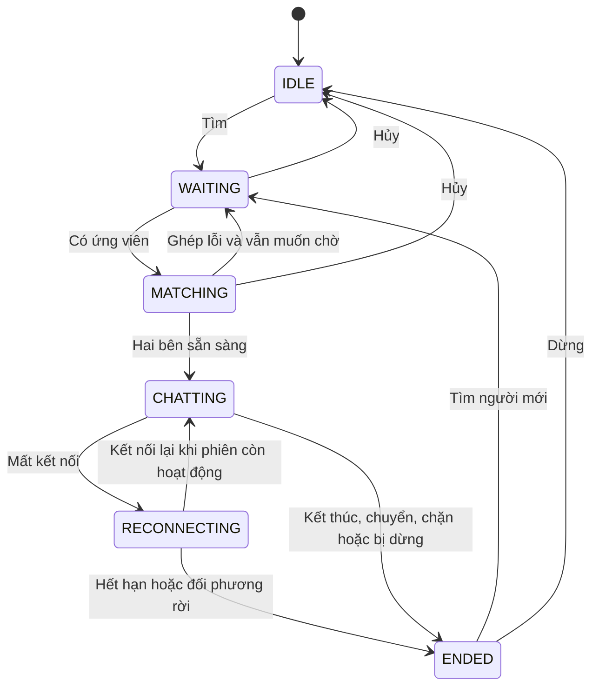
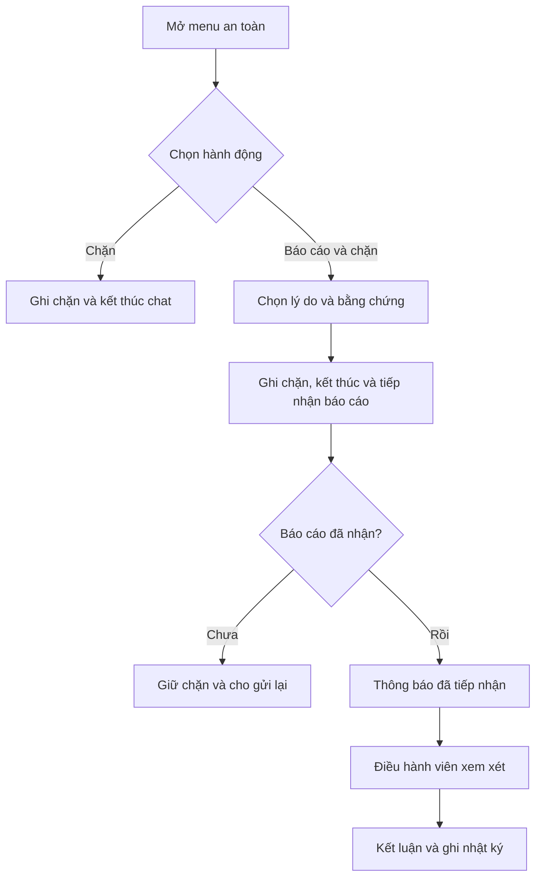
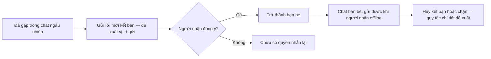
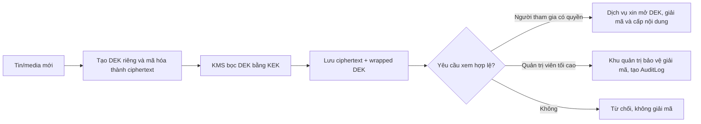

# ĐẶC TẢ NGHIỆP VỤ WEB CHAT NGẪU NHIÊN — BẢN 1.1 ĐANG THẢO LUẬN
Ngày: 07/11/2026
Ngôn ngữ giao diện: Tiếng Việt. Thiết kế ưu tiên điện thoại.
Đối tượng đọc: Chủ sản phẩm, GPT local, lập trình viên, thiết kế và kiểm thử.

> Bản làm việc ngày 07/11/2026. Phạm vi đã mở rộng sang media và chat bạn bè; các quy tắc vòng đời, dữ liệu và nghiệm thu bổ sung có nhãn trạng thái tương ứng. Các quyết định còn mở chưa được dùng như yêu cầu triển khai đã duyệt. Kế thừa bản 1.0 và cập nhật các quyết định được chủ sản phẩm xác nhận trong cuộc trao đổi. Chưa phải bản yêu cầu đã duyệt toàn bộ. Các quy tắc phụ thuộc quyết định còn mở cũng chưa được coi là đã chốt.

0. CHỈ DẪN CHO GPT LOCAL

Bạn là người phân tích và triển khai một web chat ngẫu nhiên 1–1.
Đọc toàn bộ tài liệu trước khi thiết kế hoặc viết mã. Đây là đặc tả sản phẩm của dự án này, KHÔNG phải mô tả chính xác website Chatible. Chatible chỉ là tham chiếu trải nghiệm chat đơn giản; chưa có ảnh hoặc link phiên bản cụ thể để kiểm tra trực tiếp.

Phân biệt hai cấp:
- [CHỐT]: yêu cầu người dùng đã nêu.
- [ĐỀ XUẤT]: cách xử lý đề nghị để đặc tả nhất quán; chưa được chủ sản phẩm xác nhận.
- [CẦN CHỐT]: còn thiếu quyết định; [CHỐT MỘT PHẦN]/[CHỐT PHẠM VI] chỉ xác nhận đúng phần nêu rõ. Quy tắc không mang nhãn kế thừa từ bản 1.0 cần đọc cùng quyết định phạm vi liên quan; không xem là chủ sản phẩm đã duyệt toàn bộ.
- Các mục “nghiệm thu” là tình huống cần kiểm tra khi triển khai, không phải kết quả kiểm thử đã chạy.
Không biến đề xuất thành yêu cầu đã chốt. Phạm vi đã được mở rộng trong cuộc trao đổi: có ảnh, ghi âm, video clip, kết bạn, trò chuyện lại và bộ lọc. Không tự bổ sung các tính năng khác như thanh toán hoặc AI giả làm người thật.
Được làm mô hình/prototype theo đề xuất nhưng phải ghi rõ giả định. Trước triển khai chính thức, xác nhận các quyết định còn mở ở mục 18 và 25. Không tự quyết các chính sách tuổi và lưu dữ liệu nếu chưa có phê duyệt của chủ sản phẩm.

Khi nhận tài liệu, hãy trả lại: (1) tóm tắt yêu cầu và giả định; (2) sơ đồ nghiệp vụ; (3) danh sách màn hình; (4) mô hình dữ liệu; (5) kế hoạch thực hiện theo giai đoạn; (6) các điểm còn mâu thuẫn hoặc thiếu. Không chỉ tạo giao diện giả rồi coi là đã hoàn thành hệ thống chat.

1. MỤC TIÊU VÀ PHẠM VI

[CHỐT] Web trước, ưu tiên giao diện mobile; có tạo tài khoản và đăng nhập; chọn giới tính khi khởi tạo; chọn giới tính ưu tiên tìm bạn; chat ngẫu nhiên với người lạ; chặn và xử lý người quấy rối.
[CHỐT] Hướng tương lai có thể mở rộng app và Telegram, chưa triển khai ở bản đầu.
[CHỐT — 07/11/2026] Bắt buộc đăng nhập trước khi tìm bạn. Không có chat khách ở MVP.
[CHỐT — 07/11/2026] Chỉ dành cho người từ 18 tuổi. Người dùng nhập ngày sinh riêng tư ngay khi tạo tài khoản; đối phương chỉ thấy số tuổi, không thấy ngày sinh. Đây là tuổi tự khai; không yêu cầu giấy tờ, xác minh danh tính hoặc dịch vụ xác minh tuổi bên thứ ba trong bản đầu.
[CHỐT — 07/11/2026] Bản đầu có chat chữ/emoji 1–1 và bổ sung gửi ảnh, ghi âm, video clip, kết bạn, trò chuyện lại, bộ lọc tìm người.
[CHỐT — 07/11/2026] Kết bạn cần hai bên đồng ý; sau đó được nhắn lại kể cả khi đối phương offline. Trong chat người lạ, người nhận phải chủ động bật nhận media; bạn bè được gửi media mặc định. Bộ lọc gồm giới tính và khoảng tuổi.
[CHỐT — 07/11/2026] Chat ngẫu nhiên: xem lại, báo cáo và giữ tin/media thường trong 7 ngày từ lúc kết thúc. Chat bạn bè: từng tin/media tự xóa sau 30 ngày từ lúc gửi. Bằng chứng báo cáo có thời hạn riêng.
[CẦN CHỐT] Các thời hạn bằng chứng/nhật ký/bản sao lưu, quy tắc hủy kết bạn, chi tiết quyền nhận media và giới hạn gửi.
Gửi video được hiểu là gửi clip trong tin nhắn. Gọi trực tiếp, file tùy ý, nhóm chat và thanh toán chưa được yêu cầu.
[ĐỀ XUẤT] Khu vực chat ngẫu nhiên dùng một khung thay đổi theo trạng thái. Có khu vực bạn bè và chat bạn bè riêng; người nhận và loại cuộc chat luôn được phân biệt rõ.

2. VAI TRÒ VÀ QUYỀN

Khách chưa đăng nhập: xem giới thiệu, quy tắc, đăng ký, đăng nhập, quên mật khẩu; không tìm bạn hoặc xem nội dung chat.
Thành viên: hoàn tất hồ sơ, tìm bạn, nhắn tin và gửi media theo quyền trong cuộc chat mình tham gia, kết thúc/chuyển phiên ngẫu nhiên, gửi/nhận lời mời kết bạn, chat lại với bạn bè, chặn, báo cáo, quản lý hồ sơ và tài khoản.
Điều hành viên: xử lý báo cáo được phân quyền, xem bằng chứng liên quan, cảnh cáo hoặc hạn chế theo quyền; không mặc định được đọc mọi cuộc chat.
Quản trị viên tối cao: chỉ có một tài khoản đang hoạt động ở vai trò này tại một thời điểm. Có toàn quyền phân xử trên mọi cuộc chat và media còn được hệ thống giữ, gồm chat ngẫu nhiên, chat bạn bè, nội dung nhạy cảm, media đã bị người gửi thu hồi và bằng chứng báo cáo. Khi thật sự cần thiết, có thể tìm và xem đầy đủ nội dung không cần được cấp phạm vi theo từng cuộc chat; mỗi lần mở nội dung hệ thống tự tạo AuditLog. Vai trò này có thể áp dụng/hủy hạn chế, xử lý báo cáo và xem nhật ký nghiệp vụ. Không được biết mật khẩu, mã xác thực hoặc token đăng nhập của người dùng; “toàn quyền nội dung” không làm hồi sinh tin/media đã bị dọn đúng chính sách lưu giữ.
Tài khoản bị hạn chế: được đăng nhập để xem thông báo, quản lý bảo mật và khiếu nại nếu có; quyền tìm/nhắn tùy loại hạn chế.

3. SƠ ĐỒ TỔNG THỂ (MERMAID)

4. ĐĂNG KÝ, XÁC MINH VÀ ĐĂNG NHẬP

[CHỐT — 07/11/2026] Bản đầu hỗ trợ cả Google và email + mật khẩu. Email không hiển thị cho đối phương.
[ĐỀ XUẤT] Nhánh email + mật khẩu phải xác minh email trước khi tìm bạn. Điều kiện chấp nhận xác minh từ Google và quy tắc liên kết hai phương thức chưa chốt. Telegram chưa thuộc phạm vi bản đầu.
Các AUTH-01 đến AUTH-05 mô tả nhánh email + mật khẩu. Sau xác thực Google vẫn phải kiểm tra điều kiện tuổi, chấp nhận chính sách, hạn chế và mức hoàn tất hồ sơ.

AUTH-01 [CHỐT CẬP NHẬT — 07/11/2026] Đăng ký bằng email: nhập email, mật khẩu, nhập lại mật khẩu, ngày sinh riêng tư và đồng ý điều khoản/quy tắc/riêng tư. Máy chủ tính tuổi và từ chối tài khoản khai dưới 18 tuổi. Không yêu cầu giấy tờ hoặc xác minh tuổi bên thứ ba trong bản đầu. Chính sách mật khẩu là cấu hình cần chốt; không tự đặt tiêu chuẩn không có trong tài liệu.
AUTH-02 Email hợp lệ, mật khẩu khớp, gửi yêu cầu một lần. Chống bấm gửi nhiều lần; không tạo nhiều tài khoản cho cùng định danh email theo quy tắc chuẩn hóa đã thống nhất. Không tự bỏ dấu chấm hoặc dấu cộng vì có thể nhập nhầm hai địa chỉ khác nhau thành một.
AUTH-03 Tạo tài khoản PENDING_VERIFICATION, gửi hướng dẫn xác minh. Chỉ báo đã gửi sau khi dịch vụ gửi chấp nhận; nếu lỗi có nút thử lại, không tạo lại tài khoản.
AUTH-04 Liên kết/mã xác minh có thời hạn, một lần sử dụng; xác minh thành công chuyển sang trạng thái chưa hoàn tất hồ sơ. Mã sai/hết hạn/đã dùng phải có thông báo và đường quay lại phù hợp.
AUTH-05 Gửi lại mã có thời gian chờ và giới hạn. Không xóa tài khoản chỉ vì gửi mã thất bại. Dùng thông báo không tiết lộ email có tồn tại hay không ở các luồng công khai nhạy cảm.
AUTH-06 Đăng nhập sai dùng thông báo chung. Giới hạn thử sai; không để kẻ khác khóa vĩnh viễn tài khoản chỉ bằng việc nhập sai nhiều lần.
AUTH-07 Đăng nhập thành công: kiểm tra hạn chế và mức hoàn tất hồ sơ; đưa về đúng màn hình tiếp theo. Phiên đăng nhập hết hạn trong khi chat phải ngừng quyền gửi, xử lý phiên chat rồi yêu cầu đăng nhập lại.
AUTH-08 Quên mật khẩu: phản hồi chung, mã một lần có thời hạn; gửi lại có giới hạn. Đổi thành công vô hiệu hóa mã cũ và thu hồi phiên đăng nhập theo chính sách, mặc định đề xuất thu hồi các phiên cũ, kết thúc phiên ngẫu nhiên liên quan và dừng quyền gửi từ các phiên đăng nhập bị thu hồi. Không xóa hoặc đóng vĩnh viễn luồng bạn bè chỉ vì đổi mật khẩu.
AUTH-09 Đổi mật khẩu khi đã đăng nhập cần chứng minh quyền sở hữu phù hợp. Không ghi mật khẩu/mã xác thực vào nhật ký. Đổi email cần xác minh địa chỉ mới và thông báo địa chỉ cũ; không coi email mới đã hợp lệ trước xác minh.
AUTH-10 Đăng xuất trong hàng chờ: hủy tìm; trong chat ngẫu nhiên: kết thúc phiên. Với chat bạn bè, dừng quyền truy cập trên phiên đăng nhập đó; luồng chat và tin còn hạn vẫn tồn tại. Đăng xuất thất bại do mạng: thiết bị xóa quyền truy cập cục bộ, máy chủ xử lý kết nối mất và hết hạn; không hứa kết thúc từ xa tức thì nếu chưa xác nhận.
AUTH-11 Không có dịch vụ email trong môi trường local: ghi rõ chế độ phát triển, không giả giao dịch gửi email thành công ở môi trường thật; không đưa mã xác minh vào giao diện công khai.

AUTH-12 [ĐỀ XUẤT] Đăng nhập Google cần phân biệt thành công, người dùng hủy, lỗi nhà cung cấp và phản hồi không hợp lệ. Với tài khoản Google mới, thu ngày sinh riêng tư và chấp nhận chính sách trước khi kích hoạt tài khoản; không dùng dữ liệu Google để tự suy ra tuổi. Chỉ tạo hoặc đăng nhập tài khoản sau khi máy chủ xác thực thành công; phản hồi lặp không tạo tài khoản trùng.
AUTH-13 [ĐỀ XUẤT] Nếu email từ Google trùng tài khoản sẵn có, không tự gộp chỉ dựa trên email. Yêu cầu chứng minh quyền sở hữu tài khoản hiện hữu trước khi liên kết. Luồng thông báo công khai không tiết lộ tài khoản tồn tại. Liên kết thất bại không thay đổi tài khoản cũ.
AUTH-14 [ĐỀ XUẤT] Tài khoản chỉ dùng Google không có mật khẩu nội bộ mặc định. Khi cần xác thực lại, dùng phương thức đã liên kết phù hợp. Thêm mật khẩu, liên kết hoặc gỡ Google cần quy tắc riêng; không cho gỡ phương thức truy cập cuối cùng.

5. KHỞI TẠO HỒ SƠ VÀ THIẾT LẬP

[CHỐT] Bắt buộc tự chọn giới tính lần đầu, không đặt sẵn.
[CHỐT — 07/11/2026] Lựa chọn giới tính: Nam / Nữ / Khác. Lựa chọn tìm bạn: Nam / Nữ / Khác / Không ưu tiên.
[CHỐT — 07/11/2026] Người dùng tự nhập biệt danh. Trong chat, đối phương thấy biệt danh và giới tính tự khai. Avatar mặc định vẫn là đề xuất.
ONB-01 Lưu hồ sơ phía máy chủ; tải lại/đăng nhập thiết bị khác không bắt chọn lại nếu đã hoàn tất.
ONB-02 Biệt danh là tên hiển thị, không cần duy nhất; không dùng làm khóa nhận diện hoặc khóa chặn. Giới hạn độ dài và nội dung phải được cấu hình, kiểm tra ở máy chủ.
ONB-03 [CHỐT — 07/11/2026] Giới tính tự khai, chưa xác minh và có hiển thị cho đối phương trong chat. Không thể hiện như thông tin đã được nền tảng xác thực.
ONB-04 Hồ sơ thiếu dữ liệu bắt buộc thì không được tìm bạn, kể cả gọi thẳng API.
ONB-05 Chỉ đổi giới tính khi IDLE và không có yêu cầu ghép đang xử lý; thay đổi có nhật ký và giới hạn tần suất cấu hình. Không đổi giữa phiên để tác động lựa chọn đã ghép.
ONB-06 Ưu tiên lưu làm mặc định cho lần tìm sau. Khi đang chờ muốn đổi: hủy yêu cầu hiện tại có xác nhận máy chủ rồi tạo mới. Khi đang chat: chỉ áp dụng cho lần sau.
ONB-07 [CHỐT — 07/11/2026] Nhập ngày sinh riêng tư để tính tuổi; đối phương chỉ thấy số tuổi. Không hiển thị ngày sinh hoặc đánh dấu tuổi đã được xác minh giấy tờ.
ONB-08 [CHỐT MỘT PHẦN] Máy chủ tính tuổi từ ngày sinh, từ chối ngày không hợp lệ/trong tương lai và không cho tài khoản khai dưới 18 tuổi vào tìm bạn hoặc dùng chat bạn bè. Không có xác minh tuổi bằng giấy tờ hoặc bên thứ ba trong bản đầu. Tính lại tuổi khi xét ghép để xử lý sinh nhật đúng quy tắc. Múi giờ tính tuổi, cách sửa ngày sinh và xử lý tài khoản khai dưới 18 tuổi cần chốt.

6. GHÉP NGẪU NHIÊN THEO GIỚI TÍNH VÀ KHOẢNG TUỔI

Các mục 6–8 và 10 mô tả vòng đời chat ngẫu nhiên. Vòng đời chat bạn bè được tách tại mục 21; rời màn hình hoặc offline không tự kết thúc quan hệ bạn bè hay đóng luồng chat bạn bè.

[CHỐT — 07/11/2026] Lọc giới tính hai chiều, có mở rộng tự chọn. Nếu chưa có cặp hợp lệ thì tiếp tục chờ; chỉ mở rộng sau khi người dùng chủ động đồng ý. Không tự ghép ngoài phạm vi đã chấp nhận. Cách xếp hạng sau khi mở rộng vẫn là đề xuất bên dưới.
Mỗi yêu cầu tìm có: giới tính bản thân tại lúc tìm, giới tính ưu tiên, tập giới tính được phép ghép, lựa chọn khoảng tuổi, thời điểm vào hàng, trạng thái và mã yêu cầu.
[CHỐT PHẠM VI] Có bộ lọc khoảng tuổi.
[ĐỀ XUẤT] Khoảng tuổi tính cả hai đầu mút và chỉ nhận người từ 18 tuổi. Cặp hợp lệ phải thỏa cả giới tính lẫn tuổi theo điều kiện của cả hai người. Tuổi dùng ghép phải lấy từ dữ liệu hồ sơ phía máy chủ theo phương thức khai báo được duyệt. Đổi bộ lọc khi đang chờ phải cập nhật có kiểm soát, không giữ đồng thời hai yêu cầu.
[ĐỀ XUẤT] Mở rộng giới tính và mở rộng tuổi là hai lựa chọn riêng, phải hiển thị phạm vi mới trước khi người dùng đồng ý; không tự bỏ điều kiện 18+.
- Chọn Nữ: tập được phép ban đầu = {Nữ}.
- Chọn Không ưu tiên: tập được phép = {Nam, Nữ, Khác}.
- Chọn Mở rộng tìm kiếm: tập được phép cho yêu cầu hiện tại = tất cả; vẫn giữ lựa chọn gốc làm ưu tiên xếp hạng.
- Mở rộng không tự lưu thành mặc định cho lần sau. Lần tìm tiếp theo quay về ưu tiên đã lưu.

Một cặp A/B hợp lệ khi TẤT CẢ điều kiện đúng:
1. A khác B, cả hai có tài khoản hợp lệ và được phép chat.
2. Cả hai đang trong hàng chờ có kết nối còn hiệu lực và chưa bị người khác giữ ghép.
3. Giới tính A thuộc tập B đã cho phép; giới tính B thuộc tập A đã cho phép.
4. Không có chặn đang hiệu lực ở bất kỳ chiều nào.
5. Thỏa điều kiện từ 18 tuổi và bộ lọc khoảng tuổi theo quy tắc hai chiều được duyệt; không vi phạm thời gian tránh ghép lại.

Xếp hạng [ĐỀ XUẤT]: ưu tiên khớp mong muốn hai bên, sau đó thời gian chờ; cần cơ chế chống người chờ bị bỏ đói. Không ưu tiên là trung lập, không phải ưu tiên thấp. Không đảo thứ tự hàng chờ vì thao tác làm mới trang.

Ví dụ:
- A Nam ưu tiên Nữ; B Nữ ưu tiên Nam: hợp lệ.
- A Nam ưu tiên Nữ; B Nữ ưu tiên Nữ: không hợp lệ khi chưa mở rộng.
- A Nam ưu tiên Nữ; B Nữ không ưu tiên: hợp lệ.
- Chỉ A mở rộng nhưng B vẫn chỉ nhận Nữ: A Nam vẫn không hợp lệ với B.
- Cả hai mở rộng: có thể ghép nếu các điều kiện còn lại đúng.

7. TÌM NGƯỜI VÀ XÁC NHẬN GHÉP

MATCH-01 Bấm Tìm: kiểm tra tài khoản, hồ sơ, giới hạn, phiên đang chạy. Một người có tối đa một yêu cầu tìm hoạt động.
MATCH-02 Không có ứng viên: giữ hàng chờ, hiện thời gian chờ thực tế; không giả số người, không dùng bot giả người thật.
MATCH-03 Sau thời gian cấu hình, có thể gợi ý mở rộng. Từ chối gợi ý vẫn được chờ như cũ.
MATCH-04 Ghép là thao tác nguyên tử: giữ cả hai, tạo một cuộc chat với đúng hai thành viên, bỏ cả hai khỏi hàng chờ. Kiểm tra lại hạn chế và chặn tại thời điểm hoàn tất.
MATCH-05 Trong MATCHING, chờ hai thiết bị xác nhận sẵn sàng. Chỉ CHAT khi đủ điều kiện. Nếu thất bại trước khi sẵn sàng, thông báo và đưa người vẫn đang chủ động chờ về hàng chờ, giữ thời gian chờ gốc; không làm vậy nếu họ đã hủy.
MATCH-06 Hủy tìm đồng thời được ghép: thứ tự máy chủ quyết định. Hủy trước thì không ghép; ghép trước thì thao tác hủy phải kết thúc phiên mới, không để người dùng bị mắc lại.
MATCH-07 Thay đổi hàng chờ phải có mã yêu cầu và phiên bản; yêu cầu hủy cũ không được hủy lần tìm mới.
MATCH-08 Không tự ghép lại đối tác vừa rời. [ĐỀ XUẤT] Thời gian tránh ghép lại có cấu hình; nếu không có người khác thì tiếp tục chờ hoặc cho người dùng đồng ý gặp lại, không âm thầm bỏ điều kiện.
MATCH-09 Nếu mất mạng khi chờ, tạm loại khỏi ứng viên; hết thời hạn thì đóng yêu cầu. Quay lại phải đồng bộ trạng thái, không tạo yêu cầu trùng.

Sơ đồ:

8. TRẠNG THÁI: KHÔNG TRỘN TÀI KHOẢN VỚI CUỘC CHAT

Tài khoản: PENDING_VERIFICATION / ONBOARDING / ACTIVE / DELETION_PENDING / DELETED. Hạn chế là bản ghi riêng có loại, thời hạn và lý do; không dùng một cờ ban duy nhất cho mọi tình huống.
Yêu cầu tìm: QUEUED / RESERVED / MATCHED / CANCELLED / EXPIRED.
Cuộc chat: CONNECTING / ACTIVE / ENDED; ENDED là trạng thái cuối, không mở lại ở MVP.
Trạng thái kết nối từng người: CONNECTED / RECONNECTING / DISCONNECTED.
Giao diện người dùng: IDLE / WAITING / MATCHING / CHATTING / RECONNECTING / ENDED. Trạng thái giao diện được suy ra từ dữ liệu máy chủ, không tự làm nguồn sự thật.

Lưu ý: quyền truy cập bị thu hồi có thể buộc dừng ở mọi trạng thái. Khi chuyển người, phải nhận kết quả kết thúc phiên cũ rồi mới vào WAITING, dù giao diện có thể thể hiện thành một thao tác.

9. TIN NHẮN VÀ CUỘC CHAT

CHAT-01 [CHỐT MỞ RỘNG — 07/11/2026] Có tin chữ/emoji, ảnh, ghi âm và video clip. Tin chữ cấm rỗng sau kiểm tra khoảng trắng; tin chỉ có media không bắt buộc kèm chữ. Độ dài, dung lượng, thời lượng và tốc độ gửi cần được đặc tả theo từng loại. Hiển thị chữ như văn bản, không thực thi HTML/script. Quyền cơ bản đã chốt tại MEDIA-02; chi tiết cấp/tắt quyền và giới hạn còn là đề xuất.
CHAT-02 Người gửi phải là thành viên và có quyền tại mỗi lần gửi. Với chat ngẫu nhiên, phiên phải ACTIVE. Với chat bạn bè, phải còn quan hệ bạn bè được chấp nhận và không bị chặn/hạn chế; bên nhận có thể offline. Không chỉ kiểm tra quyền lúc mở kết nối.
CHAT-03 Mỗi thao tác gửi có client_message_id; lặp lại cùng mã không tạo tin mới. Máy chủ gán message_id, thứ tự và thời điểm. Thứ tự do máy chủ quyết định, không dùng đồng hồ điện thoại.
CHAT-04 Trạng thái MVP: Đang gửi / Đã được máy chủ nhận / Gửi thất bại. Không hiển thị Đã xem nếu chưa có nghiệp vụ xác nhận xem. Khi chưa rõ kết quả, đối soát mã gửi trước khi tạo lần gửi mới.
CHAT-05 Sau mất mạng, đồng bộ tin thiếu theo mốc thứ tự của từng cuộc chat. Sự kiện trùng không tạo bong bóng trùng. Sự kiện của cuộc chat khác không được chèn vào khung đang mở. Với chat bạn bè, xử lý tin đến đúng luồng và số chưa đọc theo đề xuất ở mục 21.
CHAT-06 Đang nhập là tín hiệu tạm, tự hết hạn; không được coi là bằng chứng người còn online. Không lưu thành tin.
CHAT-07 Khi cuộc chat ngẫu nhiên kết thúc: khóa gửi, giữ nội dung trong màn hình hiện tại trong giới hạn chính sách; hiện Tìm người mới, Chặn, Báo cáo.
CHAT-08 Khi tìm cuộc chat ngẫu nhiên mới: xóa bản nháp cũ, đổi rõ đối tác và ngữ cảnh. Không tự chuyển bản nháp qua phiên mới.
CHAT-09 [CHỐT — 07/11/2026] Cho phép gửi link và thông tin liên hệ. Link hiển thị dạng chữ, không tự mở hoặc tải xem trước. Quyền này không cho phép spam, lừa đảo hay tiết lộ thông tin cá nhân của người khác trái quy tắc.
CHAT-10 Không sửa/thu hồi tin ở MVP; nếu bổ sung sau phải giữ bằng chứng báo cáo nhất quán và giải thích hành vi xóa hai phía.

10. KẾT THÚC, CHUYỂN NGƯỜI, MẤT KẾT NỐI

END-01 Kết thúc: dừng cho cả hai, không tự tìm tiếp cho bên nào.
END-02 Chuyển người: dừng phiên cũ, đưa duy nhất người chủ động vào hàng chờ mới theo ưu tiên lưu. Người còn lại tự quyết định tìm tiếp.
END-03 Hai bên chuyển cùng lúc: kết thúc một lần; mỗi bên có một yêu cầu tìm mới; tránh ghép lại ngay.
END-04 Tin và kết thúc đến cùng lúc: giao dịch nào máy chủ chấp nhận trước quyết định. Tin đã được nhận trước kết thúc có thể được đồng bộ sau; tin gửi mới sau kết thúc bị từ chối. Không tuyên bố đã xóa tin đã nhận trên thiết bị kia.
END-05 [ĐỀ XUẤT LÀM RÕ] Mở cài đặt, an toàn hoặc danh sách bạn bè trong ứng dụng không mặc định kết thúc chat ngẫu nhiên. Nếu thao tác thực sự rời phiên, phải báo hậu quả và kết thúc khi người dùng chọn rời. Tải lại trang đi theo luồng khôi phục END-07. Đóng tab đột ngột không bảo đảm nhận sự kiện rời nên cần kiểm tra kết nối. Rời màn hình chat bạn bè không kết thúc luồng chat đó.
END-06 [ĐỀ XUẤT] Chờ kết nối lại 30 giây. Một bên mất mạng, bên còn lại thấy trạng thái và được kết thúc bất kỳ lúc nào. Không tự tìm người khác thay người mất mạng.
END-07 Tải lại/đổi Wi-Fi/khóa màn hình: kiểm tra phiên hiện tại; nếu còn hoạt động thì khôi phục; nếu đã kết thúc thì hiển thị kết quả, không hồi sinh phiên.
END-08 Một người chỉ có một thiết bị điều khiển hàng chờ/phiên chat ngẫu nhiên. Quy tắc nhiều thiết bị cho chat bạn bè được đề xuất riêng tại mục 21. Tab/thiết bị mới xem thông báo và chọn Tiếp tục ở đây; chuyển quyền vô hiệu hóa quyền điều khiển nơi cũ. Lệnh cũ phải có mã phiên điều khiển để không kết thúc nhầm cuộc chat mới.

11. CHẶN VÀ BÁO CÁO

BLOCK-01 Chuyển người không tự tạo báo cáo hoặc chặn.
BLOCK-02 [CHỐT MỞ RỘNG — 07/11/2026] Chặn không cần lý do. Ghi theo user_id ổn định, không theo biệt danh/email hiển thị. Kết thúc phiên ngẫu nhiên, chặn ghép ở cả hai chiều và dừng chuyển tin mới khi lệnh có hiệu lực. Khi hai người là bạn bè, chặn đồng thời hủy quan hệ bạn bè và vô hiệu hóa lời mời đang chờ. Không tuyên bố thu hồi được tin/media đã nhận trên thiết bị đối phương.
BLOCK-03 Có thể chặn đối tác vừa kết thúc khi phiên còn nằm trong thời hạn thao tác. Không cho nhập mã người bất kỳ để xem thông tin hay chặn qua tra cứu danh tính.
BLOCK-04 [CHỐT MỞ RỘNG — 07/11/2026] Hai bên cùng chặn tạo hai bản ghi; một bên bỏ chặn không xóa bản ghi bên kia. Bỏ chặn không mở lại phiên cũ, không khôi phục quan hệ bạn bè và không khôi phục quyền nhắn. Muốn kết bạn lại, hai bên phải đồng ý qua một lời mời mới.
BLOCK-05 Danh sách chặn chỉ hiện bí danh/nhãn an toàn của người đã gặp và thời điểm, không tiết lộ danh tính tài khoản. Không hứa chặn được mọi tài khoản mới của cùng một người.

REPORT-01 Lý do: quấy rối tình dục/nội dung không mong muốn; xúc phạm/đe dọa; spam/lừa đảo; tiết lộ thông tin cá nhân; khác. Có mô tả tùy chọn, giới hạn độ dài.
REPORT-02 [ĐỀ XUẤT] Luồng chính là Báo cáo và chặn. Khi mở biểu mẫu có nút Dừng nhận tin ngay; nhấn nút này phải áp dụng chặn phía máy chủ, không chỉ ẩn tin ở giao diện.
REPORT-03 Gửi kèm mã phiên, người báo cáo, đối tượng, tin được chọn và ngữ cảnh cần thiết từ máy chủ. Kiểm tra người báo cáo từng tham gia phiên. Không tin nội dung bằng chứng do trình duyệt tự khai.
REPORT-04 Chặn và tiếp nhận báo cáo là hai kết quả phải theo dõi riêng: nếu chặn thành công nhưng gửi báo cáo lỗi, nói rõ và cho thử lại; không gỡ chặn. Chống báo cáo trùng theo mã yêu cầu.
REPORT-05 [CHỐT MỞ RỘNG — 07/11/2026] Đối phương rời hoặc đã bắt đầu chat mới vẫn có thể truy cập các phiên ngẫu nhiên gần đây để chặn/báo cáo trong 7 ngày từ lúc kết thúc. Có danh sách phiên gần đây, không chỉ giữ phiên cuối. Công bố hạn còn lại và kiểm tra hạn ở máy chủ. Bằng chứng báo cáo được tiếp nhận trong hạn có chính sách giữ riêng: giữ trong suốt thời gian xử lý và 90 ngày sau khi hồ sơ báo cáo được đóng.
REPORT-06 Người bị chặn/báo cáo chỉ thấy chat kết thúc, không thấy người gửi hoặc nội dung báo cáo. Không tiết lộ thêm ở thông báo xử lý.

Sơ đồ:

12. ĐIỀU HÀNH VÀ HẠN CHẾ VI PHẠM

MOD-01 Báo cáo: OPEN / IN_REVIEW / RESOLVED / DISMISSED. Hai điều hành viên không được vô tình ghi đè kết luận của nhau; dùng phân công hoặc kiểm tra phiên bản.
MOD-02 Xem lý do, bằng chứng cần thiết, lịch sử vi phạm đã kết luận; không coi số báo cáo là bằng chứng tự động. Nhận diện báo cáo trùng/ác ý nhưng không bỏ qua chỉ vì số lượng lớn.
MOD-03 Kết quả: không đủ căn cứ; cảnh cáo; hạn chế gửi; tạm dừng tìm; khóa tạm; khóa dài hạn. Lưu lý do, người xử lý, thời hạn và quyền khiếu nại nếu có.
MOD-04 Hạn chế tìm không nhất thiết chặn đăng nhập. Hạn chế gửi phải thông báo rõ; mức xử lý nghiêm trọng cần kết thúc phiên đang hoạt động và gỡ khỏi hàng chờ.
MOD-05 Hết hạn tự khôi phục đúng quyền, không tự đưa người dùng vào hàng chờ. Gỡ hạn chế không xóa lịch sử xử lý.
MOD-06 Quyền khiếu nại [ĐỀ XUẤT]: người dùng gửi giải trình, điều hành viên xem lại, sửa quyết định nếu nhầm; không tiết lộ danh tính người báo cáo.
MOD-07 Mọi xem bằng chứng, khóa, gỡ khóa, thay cấu hình đều có nhật ký quyền hạn phù hợp. Không log toàn bộ nội dung chat vào log kỹ thuật mặc định.
MOD-08 [CHỐT — 07/11/2026] Quản trị viên tối cao được xem đầy đủ mọi cuộc chat và media còn hạn để phân xử, không bị giới hạn vào phiên đã được báo cáo hoặc một phạm vi nội dung được cấp trước. Với media nhạy cảm hoặc media đã thu hồi, được xem bản nội dung đầy đủ còn giữ trong khu vực quản trị bảo vệ, không dùng link/URL công khai. Điều hành viên vẫn chỉ xem bằng chứng/phạm vi được phân quyền.
MOD-09 [CHỐT — 07/11/2026] Mỗi lần quản trị viên tối cao mở nội dung, hệ thống tự ghi AuditLog gồm người truy cập, vai trò, thời điểm, loại/tài nguyên đã mở và kết quả thao tác nếu có. Không bắt người quản trị phải chọn phạm vi hoặc nhập lý do trước khi xem; quy tắc vận hành là chỉ mở khi thật sự cần thiết để phân xử. Không ghi toàn bộ nội dung tin hay token media vào AuditLog. Xem nội dung nhạy cảm cần xác thực lại phù hợp và tự hết phiên khu vực quản trị theo cấu hình.
MOD-10 [CHỐT MỘT PHẦN] Quản trị viên tối cao có thể áp dụng biện pháp khẩn cấp: ẩn nội dung khỏi người nhận còn quyền, thu hồi quyền xem media, kết thúc phiên ngẫu nhiên, hủy quan hệ bạn bè, hạn chế/khóa tài khoản và bảo toàn bằng chứng. Lệnh có kiểm tra quyền phía máy chủ, được AuditLog và không được xóa bằng chứng còn hạn.
MOD-11 [CHỐT — 07/11/2026] Vai trò Quản trị viên tối cao gắn cố định với đúng một tài khoản trong toàn bộ vòng đời hệ thống; không có chuyển quyền, thay thế, vai trò thứ hai tương đương hoặc tài khoản dự phòng cùng quyền đang hoạt động. Nếu tài khoản mất quyền truy cập, hệ thống không kích hoạt tài khoản quản trị khác. Chỉ được khôi phục quyền truy cập cho chính tài khoản đã gắn vai trò, theo quy trình khôi phục bảo mật cần chốt; sự kiện khôi phục phải tạo AuditLog.

13. RIÊNG TƯ VÀ DỮ LIỆU

Người đối diện được nhận biệt danh, giới tính tự khai và số tuổi đã chốt hiển thị; avatar mặc định vẫn là đề xuất. Chỉ cung cấp dữ liệu phục vụ cuộc chat. Không trả email, mã đăng nhập, địa chỉ IP, user_id nội bộ hoặc danh sách chặn cho đối tác qua API/sự kiện. Dùng định danh công khai theo phiên nếu cần.
Ẩn danh trong sản phẩm nghĩa là không tự tiết lộ thông tin đăng nhập/danh tính thật cho đối phương; vẫn hiển thị biệt danh, giới tính và số tuổi đã chốt. Kết bạn tạo liên hệ ổn định giữa hai tài khoản. Quản trị viên tối cao duy nhất có quyền xem đầy đủ nội dung còn được giữ để phân xử; điều này phải được nêu rõ trong thông tin riêng tư. Nội dung dùng mã hóa tầng ứng dụng do hệ thống quản lý khóa; đây không phải mã hóa đầu cuối giữa hai người dùng. Không tuyên bố vô danh với đơn vị vận hành hoặc E2EE.

[CHỐT — 07/11/2026] Có các phiên ngẫu nhiên gần đây để xem lại và chặn/báo cáo trong 7 ngày từ lúc kết thúc, kể cả sau khi chuyển sang người mới. Tin/media thường của phiên được giữ trong thời hạn này.
[CHỐT — 07/11/2026] Với chat bạn bè, tự xóa từng tin/media sau 30 ngày từ lúc gửi, kể cả người nhận chưa online để đọc.
[ĐỀ XUẤT LÀM RÕ] Dùng mốc máy chủ: hạn chat ngẫu nhiên = ended_at + 7 ngày; hạn từng tin bạn bè = accepted_at + 30 ngày. Chat ngẫu nhiên đang hoạt động chưa bắt đầu thời hạn tính từ kết thúc. Báo cáo cần được tiếp nhận trước hạn; ngay khi tiếp nhận phải giữ bằng chứng nhất quán với tác vụ dọn. Chặn tài khoản bạn bè vẫn có thể thực hiện khi tin cũ hết hạn. Thời hạn gửi báo cáo chat bạn bè cần chốt riêng.
Tách rõ:
- Thời gian giao diện còn cho xem từng phiên ngẫu nhiên gần đây và mốc bắt đầu tính thời hạn.
- Thời gian giữ tin thông thường trên máy chủ.
- Thời gian giữ bằng chứng báo cáo và nhật ký xử lý.
Thời hạn tin/media thường đã chốt như trên. [CHỐT — 07/11/2026] Bằng chứng báo cáo được giữ trong lúc xử lý và 90 ngày sau khi hồ sơ báo cáo được đóng, tính theo mốc máy chủ. Thời hạn nhật ký và xử lý bản sao lưu còn cần chốt. Không suy ra giữ vĩnh viễn. Cần bảo đảm bằng chứng được giữ từ thời điểm báo cáo hợp lệ được tiếp nhận, độc lập với tác vụ dọn tin thường.
Tác vụ dọn dữ liệu phải xử lý bản sao lưu và bản ghi phụ theo chính sách, không chỉ xóa bong bóng chat.
Xóa tài khoản cần xác minh lại, kết thúc chat ngẫu nhiên/hủy tìm, thu hồi phiên và dừng quyền gửi ở chat bạn bè; bằng chứng cần giữ được tách và hạn chế truy cập theo chính sách. Không hứa xóa mọi bằng chứng báo cáo tức thời.
Không thể bảo đảm ngăn người đối diện chụp ảnh/quay màn hình hoặc sao chép nội dung. Với media nhạy cảm, phải nêu giới hạn này trước khi người dùng bật quyền nhận; chế độ hạn chế lưu chỉ làm giảm khả năng truy cập/tải trực tiếp, không phải cam kết ngăn tuyệt đối. Không dùng cảnh báo làm gián đoạn mọi cuộc chat thường.

14. MÀN HÌNH VÀ HÀNH VI MOBILE

S01 Giới thiệu: giá trị sản phẩm, Đăng ký, Đăng nhập, quy tắc và riêng tư.
S02 Đăng ký; S03 Xác minh email; S04 Đăng nhập; S05 Quên/đặt lại mật khẩu.
S06 Khởi tạo: giới tính bắt buộc, biệt danh, ưu tiên và điều kiện cần thiết.
S07 Chat chính: IDLE/WAITING/MATCHING/CHATTING/RECONNECTING/ENDED trên cùng một khung.
S08 An toàn: chặn, báo cáo và chọn bằng chứng; vẫn truy cập được sau khi đối phương rời trong thời hạn.
S09 Hồ sơ/cài đặt: biệt danh, giới tính, ưu tiên, bảo mật, chặn, đăng xuất, xóa tài khoản.
S10 Thông báo hạn chế và khiếu nại.
S11 Quản trị riêng: hàng báo cáo, tìm/xem mọi cuộc chat và media còn giữ, chi tiết bằng chứng, xử lý tài khoản, cấu hình và nhật ký truy cập/hành động. Điều hành viên chỉ thấy phạm vi được cấp; Quản trị viên tối cao duy nhất thấy toàn bộ theo MOD-08.

Khung chat: trên là biệt danh, giới tính tự khai, số tuổi của đối phương, trạng thái và menu an toàn; giữa là tin và thông báo hệ thống; dưới là ô nhập và gửi. Tách vị trí Kết thúc/Chuyển người khỏi Gửi.
WAITING có Hủy và thay đổi ưu tiên; thay đổi phải đi qua hủy yêu cầu cũ. ENDED giữ nội dung và hiện Tìm người mới cùng Chặn/Báo cáo.
Bàn phím không che ô nhập; vùng thao tác đủ dễ bấm; không ép cuộn khi đọc tin cũ; có nút tin mới; xử lý màn hình ngang, chữ lớn, vùng an toàn và bàn phím tiếng Việt. Enter/gửi phải tránh gửi khi bộ gõ đang hoàn tất ký tự.
Không chỉ dùng màu để biểu thị lỗi hoặc trạng thái. Thông báo hỗ trợ trình đọc màn hình. Chuyển trang không làm mất bản nháp cùng phiên, nhưng bắt đầu phiên mới phải xóa bản nháp cũ.

15. DỮ LIỆU NGHIỆP VỤ TỐI THIỂU

User: id, thông tin đăng nhập riêng tư, trạng thái, mốc xác minh/tạo/xóa.
Profile: user_id, biệt danh, giới tính, ngày sinh riêng tư, ưu tiên giới tính/khoảng tuổi mặc định, mốc hoàn tất và thay đổi. Số tuổi được tính từ ngày sinh, không công khai ngày sinh.
ExternalIdentity [ĐỀ XUẤT]: user_id, nhà cung cấp, định danh ổn định từ nhà cung cấp, mốc liên kết. Một định danh nhà cung cấp không được thuộc hai tài khoản; không dùng email làm định danh Google duy nhất.
AgeEligibility [ĐỀ XUẤT]: trạng thái đáp ứng điều kiện 18+, nguồn ngày sinh tự khai và mốc xác nhận. Ngày sinh đã được chốt thu thập trong Profile; chưa có yêu cầu thu giấy tờ xác minh.
AuthSession: user_id, thiết bị/phiên, thời hạn, trạng thái thu hồi. ChatControlLease: quyền điều khiển hiện tại và phiên bản, có thể là thực thể riêng.
VerificationToken: loại xác minh, định danh, giá trị được bảo vệ, hạn dùng, đã sử dụng.
MatchRequest: id, user_id, ảnh chụp lựa chọn lúc tìm, tập cho phép, thời gian chờ gốc, trạng thái, phiên bản.
Conversation: id, trạng thái, mốc tạo/bắt đầu/kết thúc, lý do kết thúc.
Participant: conversation_id, user_id, nhãn hiển thị theo phiên, kết nối, mốc hoạt động. Đúng hai thành viên khác nhau.
Message: id, conversation_id, sender_id, client_message_id, số thứ tự máy chủ, ciphertext nội dung, metadata mã hóa, thời điểm và hạn giữ. Không lưu nội dung chữ rõ trong bảng nghiệp vụ hoặc nhật ký kỹ thuật.
Block: người chặn, người bị chặn, mốc tạo/gỡ. Ràng buộc không trùng chặn đang hiệu lực cùng chiều.
Report: id, phiên, người gửi, đối tượng, lý do, mô tả, trạng thái, mốc gửi, người xử lý.
ReportEvidence: bản chụp bằng chứng cần thiết được bảo vệ và thời hạn riêng; vẫn đọc được khi tin thông thường đến hạn xóa nếu chính sách cho phép.
Restriction: người bị áp dụng, loại, bắt đầu/kết thúc, lý do, nguồn quyết định, trạng thái gỡ.
ModerationAction/AuditLog: hành động, người thực hiện, vai trò, mục tiêu, thời điểm, lý do/mục đích, phạm vi truy cập và thay đổi cần thiết. Không ghi mật khẩu, token đăng nhập, token xem media hoặc toàn bộ nội dung chat vào log kỹ thuật.
AdminContentAccess [CHỐT]: Quản trị viên tối cao, cuộc chat/media hoặc phạm vi đã truy cập, thời điểm mở/đóng, trạng thái xác thực lại và hành động tiếp theo. Mục đích phân xử có thể ghi bổ sung nhưng không bắt buộc trước khi mở. Bản ghi này phục vụ kiểm tra quyền, không phải bản sao nội dung chat.
PolicyAcceptance: user_id, phiên bản quy tắc/riêng tư đã chấp nhận, thời điểm.

Đây là mô hình logic, không bắt buộc bảng vật lý hoặc công nghệ cụ thể. Không dùng số người online ở trình duyệt làm nguồn ghép đôi.

16. LỖI, BẢO MẬT VÀ VẬN HÀNH

Máy chủ là nguồn trạng thái. Các thao tác tạo tài khoản, vào hàng chờ, ghép, kết thúc, gửi tin, chặn, báo cáo phải chống lặp và tranh chấp.
Mỗi sự kiện chat có mã phiên; mỗi lệnh liên quan trạng thái có mã yêu cầu/phiên bản phù hợp. Quyền được kiểm tra ở máy chủ cho từng thao tác.
Chống đoán mã phiên, truy cập chat của người khác, giả người gửi, tái sử dụng phiên đăng nhập đã thu hồi. Bảo vệ phiên web khỏi lấy cắp và thao tác giả mạo; mật khẩu lưu bằng cơ chế băm thích hợp, không lưu dạng rõ.
Giới hạn theo tài khoản và tín hiệu rủi ro; không cấm vĩnh viễn chỉ theo IP vì mạng dùng chung. Ngưỡng là cấu hình, không ghi cứng các con số chưa chốt.
Quá tải: ngừng nhận tìm mới, báo trạng thái thật. Không nhận vào hàng chờ giả hoặc báo đã ghép khi chưa tạo được phiên.
Máy chủ khởi động lại: khôi phục phiên từ nguồn trạng thái hoặc kết thúc rõ ràng. Không để một người ở WAITING trong khi người kia CHATTING vô hạn.
Bảo trì: ngừng nhận phiên mới, thông báo phiên hiện tại theo kế hoạch. Không đưa nội dung tin, mật khẩu, token vào báo lỗi.
Số liệu: thời gian ghép theo nhóm ưu tiên, tỷ lệ tìm bị hủy, tỷ lệ chat có tin hai chiều, lỗi gửi, kết nối lại, chặn/báo cáo, thời gian xử lý. Không dùng thời gian chat dài làm mục tiêu duy nhất.

17. CASE NGHIỆM THU BẮT BUỘC

T01 Email trùng/gửi đăng ký lặp không tạo hai tài khoản; người ngoài không tra cứu được tài khoản qua thông báo công khai.
T02 Mã xác minh sai, hết hạn, dùng lại không cho vào tìm bạn.
T03 Quên mật khẩu, gửi lại và đổi mật khẩu không để token cũ tiếp tục dùng.
T04 Tài khoản thiếu giới tính/ưu tiên không vào hàng chờ dù gọi API trực tiếp.
T05 A Nam nhận Nữ; B Nữ nhận Nam: ghép thành công.
T06 A Nam nhận Nữ; B Nữ chỉ nhận Nữ: không ghép khi chưa được cả hai cho phép.
T07 Chỉ một bên mở rộng không vượt điều kiện bên kia.
T08 Hai thao tác Tìm liên tục chỉ tạo một yêu cầu.
T09 Hủy tìm và ghép đồng thời: kết quả nhất quán cho cả hai.
T10 Nhiều ứng viên tranh cùng một người: chỉ một cặp thành công.
T11 Đổi ưu tiên khi chờ không để yêu cầu cũ còn hoạt động.
T12 Chặn xảy ra đúng lúc ghép: không tạo phiên còn quyền chat giữa hai người đã chặn.
T13 Gửi lại cùng client_message_id không tạo tin trùng.
T14 Tin và kết thúc đồng thời tuân theo thứ tự chấp nhận máy chủ; không nhận tin mới sau ENDED.
T15 Sự kiện đến muộn của phiên cũ không xuất hiện trong chat mới.
T16 Hai bên chuyển cùng lúc tạo một lần kết thúc và tối đa một yêu cầu mới mỗi người.
T17 Chặn ngăn ghép lại dù đổi biệt danh, đăng nhập thiết bị khác hoặc tải lại.
T18 Hai bên cùng chặn, một bên bỏ chặn: vẫn không ghép được.
T19 Báo cáo vẫn gửi được khi đối phương vừa rời; người ngoài không lấy được bằng chứng của phiên.
T20 Gửi báo cáo lỗi nhưng chặn thành công: giữ chặn và cho thử lại không trùng báo cáo.
T21 Đổi Wi-Fi/4G hoặc tải lại trong thời hạn: khôi phục đúng phiên và tin thiếu.
T22 Đối phương rời khi mình mất mạng: quay lại thấy đã kết thúc, không gửi tiếp.
T23 Hai tab/thiết bị không đồng thời điều khiển chat ngẫu nhiên; lệnh từ tab cũ không kết thúc phiên mới.
T24 Hạn chế nghiêm trọng đang áp dụng dừng quyền gửi và tìm ở mọi thiết bị.
T25 Hết hạn hạn chế khôi phục quyền nhưng không tự ghép.
T26 Khóa/xóa/đăng xuất khi đang chờ dọn yêu cầu; khi chat ngẫu nhiên kết thúc đúng phía còn lại. Với bạn bè, thu hồi quyền phù hợp và giữ/xóa dữ liệu đúng chính sách, không dùng ENDED của chat ngẫu nhiên.
T27 Nội dung script là chữ, không chạy; sửa sender_id/conversation_id không mạo danh hoặc đọc được chat.
T28 Bàn phím mobile, bộ gõ tiếng Việt, màn hình nhỏ, chữ lớn và đọc tin cũ hoạt động đúng.
T29 Khởi động lại hoặc quá tải không ghép đôi hai lần và không báo gửi thành công nếu chưa nhận tin.
T30 Dọn tin thường đúng hạn không xóa nhầm bằng chứng còn thời hạn; dữ liệu quá hạn bị dọn theo chính sách.
T31 Hai điều hành viên xử lý đồng thời không ghi đè quyết định âm thầm.
T32 Tạo tài khoản mới không tự vượt qua mọi biện pháp chống lạm dụng; phải thể hiện đúng giới hạn của nhận diện, không hứa chặn tuyệt đối.

18. TRẠNG THÁI CÁC QUYẾT ĐỊNH TỪ BẢN 1.0

Q01 [CHỐT — 07/11/2026] Bắt buộc đăng nhập trước khi tìm bạn; không có chat khách.
Q02 [CHỐT MỘT PHẦN — 07/11/2026] Có cả Google và email + mật khẩu. Xác minh email, liên kết tài khoản trùng email, thêm/gỡ phương thức và khôi phục truy cập còn cần chốt.
Q03 [CHỐT — 07/11/2026] Chỉ người từ 18 tuổi; nhập ngày sinh riêng tư lúc tạo tài khoản, hiển thị số tuổi. Tuổi là tự khai; không yêu cầu xác minh giấy tờ/bên thứ ba trong bản đầu. Còn cần chốt cách sửa ngày sinh và xử lý tài khoản khai dưới 18 tuổi.
Q04 [CHỐT — 07/11/2026] Giới tính: Nam/Nữ/Khác; lựa chọn tìm bạn có thêm Không ưu tiên.
Q05 [CHỐT — 07/11/2026] Lọc giới tính hai chiều; chỉ mở rộng khi người dùng đồng ý. Không có ứng viên thì tiếp tục chờ.
Q06 [CHỐT — 07/11/2026] Hiển thị giới tính tự khai cùng biệt danh trong chat.
Q07 [CHỐT MỘT PHẦN — 07/11/2026] Có biệt danh tự nhập. Avatar mặc định và các giới hạn biệt danh vẫn là đề xuất.
Q08 [CHỐT — 07/11/2026] Phiên ngẫu nhiên được xem lại/báo cáo trong 7 ngày sau kết thúc; tin/media bạn bè tự xóa sau 30 ngày từ lúc gửi.
Q09 [CHỐT MỘT PHẦN — 07/11/2026] Tin/media ngẫu nhiên 7 ngày sau kết thúc, tin/media bạn bè 30 ngày từ lúc gửi, bằng chứng báo cáo trong thời gian xử lý và 90 ngày sau khi đóng hồ sơ. Thời hạn nhật ký, bản sao lưu và báo cáo tin bạn bè còn cần chốt.
Q10 [CHỐT — 07/11/2026] Có kết bạn và trò chuyện lại ngay bản đầu. Hai bên đồng ý mới được nhắn lại; bạn bè được nhận tin khi offline. Chặn đồng thời hủy kết bạn; bỏ chặn muốn kết bạn lại cần một lời mời và sự đồng ý mới của hai bên. Thời hạn tin/media bạn bè là 30 ngày.
Q11 [CHỐT — 07/11/2026] Cho gửi link và thông tin liên hệ; link dạng chữ, không tự mở hoặc tải xem trước.
Q12 Các ngưỡng: thời gian chờ mở rộng, tránh ghép lại, hạn mức gửi, đổi giới tính, thử đăng nhập, hạn chế vi phạm? Chưa chốt; đề xuất quản lý bằng cấu hình. Chờ kết nối lại 30 giây chỉ là giá trị thử nghiệm.

19. THỨ TỰ TRIỂN KHAI ĐỀ XUẤT

Các giai đoạn dưới đây là thứ tự xây dựng trong cùng phạm vi bản đầu, không tự chuyển ảnh/ghi âm/video/kết bạn sang bản phát hành sau.
Giai đoạn 1: hoàn thiện các quyết định mở, hai loại cuộc chat, quyền, dữ liệu và prototype mobile.
Giai đoạn 2: Google + email/mật khẩu, xác minh/khôi phục/liên kết tài khoản, hồ sơ ngày sinh/giới tính/biệt danh, phân quyền và KMS/danh tính dịch vụ nền tảng.
Giai đoạn 3: hàng chờ, ghép hai chiều theo giới tính/khoảng tuổi, hủy/tải lại/nhiều tab; chat chữ ngẫu nhiên thật được lưu mã hóa, kết thúc/chuyển/kết nối lại.
Giai đoạn 4: chặn, báo cáo, danh sách phiên gần đây, bằng chứng, điều hành, Quản trị viên tối cao và hạn chế; thực thi thời hạn dữ liệu cùng AuditLog/KeyAccessAudit.
Giai đoạn 5: lời mời kết bạn, quan hệ bạn bè, chat lại khi offline, đồng bộ nhiều luồng và quyền liên hệ.
Giai đoạn 6: ảnh/ghi âm/video, quyền nhận media, xử lý/tải/xem tệp được mã hóa, watermark/thu hồi media nhạy cảm, bằng chứng media và dọn dữ liệu liên quan.
Giai đoạn 7: hoàn thiện cả hai luồng mobile, lỗi mạng, bàn phím, microphone, khả năng tiếp cận và thông báo trạng thái.
Giai đoạn 8: kiểm tra đồng thời, quyền truy cập nội dung, các thời hạn xóa, tải media/vận hành và toàn bộ ca nghiệm thu đã duyệt trước phát hành.
Mỗi giai đoạn phải chứng minh hành vi hoạt động thực tế. Tách dữ liệu demo khỏi dữ liệu thật và không trình bày mô phỏng như hệ thống chat đã hoàn thiện.

20. NHẬT KÝ QUYẾT ĐỊNH TRONG LẦN RÀ SOÁT

D01 — CHỐT: bắt buộc đăng nhập trước khi tìm bạn. Nguồn: câu trả lời chủ sản phẩm ngày 07/11/2026.
D02 — CHỐT: hỗ trợ Google và email + mật khẩu ngay ở bản đầu. Nguồn: cùng lần trả lời trên.
D03 — CHỐT: chỉ phục vụ người từ 18 tuổi. Nguồn: cùng lần trả lời trên. Không suy ra phương thức kiểm tra tuổi đã được duyệt.
D04 — CHỐT: giới tính Nam/Nữ/Khác; tìm bạn có thêm Không ưu tiên.
D05 — CHỐT: tiếp tục chờ và chỉ mở rộng khi người dùng đồng ý; phải thỏa điều kiện hai bên.
D06 — CHỐT: hiển thị biệt danh tự nhập và giới tính tự khai trong chat.
D07 — CHỐT: xem các phiên ngẫu nhiên gần đây để chặn/báo cáo; thời hạn được chốt bổ sung tại D14.
D08 — CHỐT: cho gửi link/thông tin liên hệ, link dạng chữ và không tải xem trước.
D09 — CHỐT PHẠM VI: bổ sung ảnh, ghi âm, video clip, kết bạn, trò chuyện lại và bộ lọc ngay bản đầu.
D10 — CHỐT: kết bạn cần hai bên đồng ý; chỉ bạn bè được nhắn lại, bao gồm gửi khi đối phương offline.
D11 — CHỐT: người nhận trong chat lạ chủ động bật nhận media; bạn bè gửi được mặc định.
D12 — CHỐT PHẠM VI: bộ lọc bổ sung là khoảng tuổi. Chưa bổ sung khu vực, sở thích hoặc ngôn ngữ.
D13 — CHỐT: nhập ngày sinh riêng tư, hiển thị số tuổi; là thông tin tự khai.
D14 — CHỐT: xem lại/báo cáo và giữ tin/media ngẫu nhiên 7 ngày từ lúc kết thúc.
D15 — CHỐT: tự xóa từng tin/media bạn bè sau 30 ngày từ lúc gửi.
D16 — CHỐT: chặn đồng thời hủy kết bạn; bỏ chặn không khôi phục quan hệ, muốn kết bạn lại cần lời mời và đồng ý mới của hai bên.
D17 — CHỐT: giữ bằng chứng báo cáo trong quá trình xử lý và 90 ngày sau khi đóng hồ sơ báo cáo.
D18 — CHỐT PHẠM VI: có thể cho phép nội dung tình dục giữa người lớn có đồng thuận; chính sách chi tiết phải được duyệt trước khi phát hành.
D19 — ĐỀ XUẤT ĐÃ GHI: tách quyền nhận media, quyền nhận nội dung nhạy cảm và cam kết của người gửi thành ba nghiệp vụ riêng; không coi bất kỳ nghiệp vụ nào là bằng chứng nền tảng đã xác minh tuổi hay sự đồng thuận của người trong media.
D20 — CHỐT: media nhạy cảm được gửi trong cả chat ngẫu nhiên và chat bạn bè khi đủ quyền; chỉ mở luồng này qua nút riêng lúc gửi ảnh/video.
D21 — CHỐT VỀ KỲ VỌNG: có chế độ hạn chế lưu cho media nhạy cảm, nhưng web không thể chống chụp màn hình hoặc sao chép tuyệt đối.
D22 — CHỐT: watermark theo người nhận là bắt buộc mặc định trên mọi ảnh/video nhạy cảm; chỉ chứa nhãn an toàn và mã truy vết, không chứa email hay định danh nội bộ.
D23 — CHỐT: không hiển thị link tải, không dùng URL công khai/cố định cho media nhạy cảm; người gửi có thể chủ động thu hồi quyền xem media của mình.
D24 — CHỐT: truy cập xem dùng khóa token mờ theo người nhận và phiên xem; không để lộ đường dẫn lưu trữ thật. Thời hạn và số lần dùng token còn cần chốt.
D25 — CHỐT: quản trị viên có toàn quyền xem mọi cuộc chat/media còn được giữ, kể cả media đã thu hồi, để phân xử; mọi truy cập phải có AuditLog và không bao gồm mật khẩu hay token đăng nhập của người dùng.
D26 — CHỐT: một Quản trị viên tối cao cố định trong toàn bộ vòng đời hệ thống, không chuyển quyền; khi mở nội dung hệ thống tự tạo AuditLog, không bắt nhập lý do hoặc được cấp phạm vi trước. Quy tắc vận hành là chỉ dùng quyền này khi thật sự cần thiết để phân xử.
D27 — CHỐT: dùng envelope encryption + KMS cho dữ liệu lưu trữ; người nhận hợp lệ và Quản trị viên tối cao có thể giải mã qua luồng được kiểm soát/AuditLog. Sản phẩm không gọi đây là E2EE.
D28 — CHỐT: ngày sinh tự khai lúc tạo tài khoản là đủ điều kiện tuổi cho bản đầu, kể cả media nhạy cảm; không có giấy tờ hoặc dịch vụ xác minh tuổi bên thứ ba.
D29 — CHỐT: mỗi ảnh dưới 30 MB và mỗi video clip dưới 100 MB; máy chủ kiểm tra kích thước thực trước khi xử lý/công bố.
D30 — CHỐT: dùng customer-managed KMS key thuộc tài khoản cloud của chủ sản phẩm; không tự dựng KMS/HSM riêng trong bản đầu.
Các đề xuất AUTH-12/13/14 và thực thể dữ liệu bổ sung là nội dung phân tích, chưa phải quyết định đã duyệt.

21. KẾT BẠN VÀ TRÒ CHUYỆN LẠI

FRI-01 [CHỐT] Chỉ khi hai bên đồng ý kết bạn mới có quyền nhắn lại. Bạn bè có thể gửi tin khi đối phương offline; không cần ghép ngẫu nhiên lại.
FRI-02 [ĐỀ XUẤT] Gửi lời mời từ cuộc chat ngẫu nhiên hoặc một phiên gần đây còn thời hạn truy cập. Không có tìm kiếm người lạ bằng email, mã nội bộ hoặc danh bạ ở bản đầu. Không suy ra quyền tìm kiếm tài khoản từ tính năng kết bạn.
FRI-03 [ĐỀ XUẤT] Lời mời có trạng thái PENDING / ACCEPTED / DECLINED / CANCELLED / EXPIRED. Người nhận chấp nhận hoặc từ chối; người gửi có thể thu hồi khi còn PENDING. Chỉ một lời mời đang hiệu lực trên mỗi cặp, chống gửi trùng và đặt giới hạn mời lại. Hai lời mời chéo không tự được tính là chấp nhận nếu chưa chốt cách thông báo đồng ý.
FRI-04 [ĐỀ XUẤT] Khi chấp nhận, tạo một quan hệ bạn bè và một luồng chat bạn bè cho cặp đó theo thao tác chống lặp. Phiên ngẫu nhiên hiện tại tiếp tục cho đến khi được kết thúc; không tự kết thúc, không tự sao chép lịch sử/media của phiên ngẫu nhiên sang luồng bạn bè. Có nút mở chat bạn bè rõ ràng.
FRI-05 [ĐỀ XUẤT] Hủy kết bạn thu hồi quyền gửi tin mới từ cả hai phía nhưng không tự xóa lịch sử còn được giữ theo chính sách. Kết bạn lại cần hai bên đồng ý. Việc dùng lại luồng cũ hay tạo luồng mới còn cần chốt.
FRI-06 [CHỐT — 07/11/2026] Chặn có hiệu lực trên cả hai loại chat, hủy lời mời đang chờ và chấm dứt quan hệ bạn bè. Bỏ chặn không tự khôi phục quan hệ hoặc mở lại phiên ngẫu nhiên. Muốn kết bạn lại phải qua lời mời mới được hai bên đồng ý. Chỉ xóa lịch sử theo chính sách đã công bố.
FRI-07 [ĐỀ XUẤT] Một người vẫn chỉ có tối đa một yêu cầu tìm hoặc phiên ngẫu nhiên đang hoạt động, nhưng có thể có nhiều luồng bạn bè. Được mở/nhắn chat bạn bè trong khi đang chờ hoặc đang chat ngẫu nhiên; giao diện phải phân biệt rõ người nhận, không chuyển bản nháp hay media đang tải sang luồng khác.
FRI-08 [ĐỀ XUẤT] Tin khi offline được máy chủ tiếp nhận, lưu theo thời hạn của chat bạn bè và đồng bộ khi người nhận quay lại. “Đã được máy chủ nhận” không có nghĩa đã giao/đã đọc. Chưa mặc định có thông báo đẩy ngoài trình duyệt, email báo tin hoặc dấu đã xem. Đề xuất có số tin chưa đọc trong ứng dụng.
FRI-09 [ĐỀ XUẤT] Chat bạn bè đồng bộ trên các phiên đăng nhập được phép. Quyền điều khiển duy nhất trong END-08 chỉ áp dụng hàng chờ/chat ngẫu nhiên. Thu hồi phiên đăng nhập dừng quyền gửi từ thiết bị đó ở cả hai loại chat.
FRI-10 [CẦN CHỐT] Mức định danh ổn định giữa bạn bè, lịch sử tên cũ, hiển thị online và thời hạn lời mời. Các trường hiển thị đã chốt là biệt danh, giới tính tự khai và số tuổi; ngày sinh riêng tư. Không tự công khai danh sách bạn bè hoặc định danh Google/email.

22. ẢNH, GHI ÂM VÀ VIDEO CLIP

MEDIA-01 [CHỐT] Hỗ trợ gửi ảnh, ghi âm và video clip. Đây là tin nhắn media, không phải cuộc gọi trực tiếp. Không suy ra hỗ trợ mọi loại tệp đính kèm.
MEDIA-02 [CHỐT] Trong chat người lạ, người nhận phải bật đồng ý nhận media; bạn bè được gửi media mặc định.
MEDIA-03 [ĐỀ XUẤT] Quyền nhận media có hiệu lực theo từng người nhận trong từng phiên ngẫu nhiên, mặc định tắt ở mỗi phiên mới. A cho phép nhận không đồng nghĩa B cho phép nhận. Một công tắc bao gồm ảnh, ghi âm và video, có mô tả rõ ba loại. Có thể tắt lại bất kỳ lúc nào để chặn tin media mới; không xóa ngược nội dung đã nhận.
MEDIA-04 [ĐỀ XUẤT] Kiểm tra quyền cả trước khi bắt đầu tải lên và trước khi công bố tin media. Nếu đối phương tắt nhận, kết thúc, hủy kết bạn hoặc chặn trong lúc tải, không công bố tin mới nếu quyền đã mất. Thao tác cạnh tranh tuân theo thứ tự máy chủ chấp nhận; không hứa thu hồi bản đã tải xuống.
MEDIA-05 [ĐỀ XUẤT] Luồng gửi: chọn/ghi → xem hoặc nghe thử → gửi → tải lên → kiểm tra/xử lý → máy chủ tiếp nhận tin hoặc báo lỗi. Hủy bản nháp/ghi âm chưa gửi không tạo tin phía đối phương. Các trạng thái tải và xử lý phải phân biệt với đã gửi.
MEDIA-06 [ĐỀ XUẤT] Microphone chỉ được yêu cầu khi người dùng bắt đầu ghi âm. Nếu từ chối quyền hoặc thiết bị không hỗ trợ, vẫn cho gửi chữ và chọn các media được hỗ trợ. Bị gián đoạn trong lúc ghi cần báo rõ kết quả, không tự gửi bản ghi dở.
MEDIA-07 [CHỐT MỘT PHẦN — 07/11/2026] Mỗi ảnh gửi lên phải nhỏ hơn 30 MB (30.000.000 byte); mỗi video clip gửi lên phải nhỏ hơn 100 MB (100.000.000 byte). Máy chủ kiểm tra giới hạn theo kích thước thực trước khi xử lý/công bố; không chỉ dựa trên khai báo của trình duyệt hoặc phần mở rộng. Tệp vượt giới hạn bị từ chối rõ ràng và không tạo tin/media hiển thị phía người nhận. Giới hạn ghi âm, định dạng, thời lượng, số tệp mỗi tin, hạn mức tài khoản và tổng lưu trữ còn cần chốt.
MEDIA-08 [ĐỀ XUẤT] Tệp gắn với người gửi, cuộc chat và thao tác gửi; không dùng lại tệp của người khác hoặc tự đổi sang cuộc chat khác. Thử lại không tạo tin trùng. Tệp tải dở, tải lỗi hoặc không bao giờ được gửi phải được dọn theo thời hạn riêng.
MEDIA-09 [ĐỀ XUẤT] Media chỉ truy cập được theo quyền của cuộc chat hoặc quyền xem bằng chứng. Không dùng thư viện tệp công khai. Bản gốc, bản chuyển đổi và ảnh xem trước đều phải theo cùng chính sách quyền và thời hạn. Không đưa thông tin vị trí/metadata nhạy cảm không cần thiết vào bản gửi cho đối phương.
MEDIA-10 [ĐỀ XUẤT] Không tự phát ghi âm hoặc video. Cho xem ảnh, nghe và điều khiển phát video trong ứng dụng. Giới hạn nhận media phải có giải thích dễ hiểu ở cả phía gửi và nhận. Quyền tải/lưu media và cách che nội dung xem trước còn cần chốt.
MEDIA-11 [CHỐT MỞ RỘNG — 07/11/2026] Báo cáo chọn được tin media cùng ngữ cảnh cần thiết. Bằng chứng được giữ trong lúc xử lý và 90 ngày sau khi hồ sơ báo cáo đóng; việc tin thường hết hạn không làm mất bằng chứng đang còn hạn. Điều hành viên chỉ truy cập media bằng chứng trong phạm vi phân quyền, có nhật ký truy cập.
MEDIA-12 [CHỐT PHẠM VI — 07/11/2026] Có thể cho phép nội dung tình dục giữa người lớn có đồng thuận. Đây là chính sách nội dung riêng, không tự phát sinh từ việc người nhận bật nhận media và không thay thế nghĩa vụ bảo vệ người dùng. Cần chốt điều kiện được phép, nội dung bị cấm, cách xác định độ tuổi, cơ chế đồng thuận, cách báo cáo/xử lý, khiếu nại và năng lực kiểm duyệt trước khi phát hành.

22A. CHÍNH SÁCH NỘI DUNG NHẠY CẢM DÀNH CHO NGƯỜI LỚN

ADULT-01 [CHỐT PHẠM VI — 07/11/2026] Nền tảng có thể cho phép ảnh hoặc video mang tính tình dục giữa người lớn có đồng thuận. Ghi âm không được coi là một ngoại lệ mặc định: nếu nội dung ghi âm có tính nhạy cảm, áp dụng cùng chính sách này.
ADULT-02 [CHỐT] Việc một người bật nhận media chỉ là quyền kỹ thuật nhận ảnh/ghi âm/video; không phải sự đồng ý nhận nội dung tình dục, không chứng minh sự đồng thuận của người xuất hiện trong media, và không thay thế quyền chặn/báo cáo.
ADULT-03 [CHỐT — 07/11/2026] Cho phép gửi ảnh/video nhạy cảm trong cả chat ngẫu nhiên và chat bạn bè khi quyền của hai phía còn hiệu lực. Trong khung gửi ảnh/video có nút “Nội dung người lớn”; chỉ khi người gửi chủ động bấm nút này mới mở luồng gắn nhãn và xác nhận trước khi gửi. Không tự gắn nhãn từ thao tác gửi media thông thường.
ADULT-03A [ĐỀ XUẤT] Người nhận phải bật một lựa chọn riêng để nhận nội dung nhạy cảm; mặc định tắt, có hiệu lực theo từng cuộc chat và có thể tắt bất kỳ lúc nào. Người gửi thấy rõ khi người nhận chưa bật quyền, và không được tải/công bố media nhạy cảm khi quyền không còn hiệu lực. Cần chốt liệu người gửi cũng phải bật một lựa chọn trước mỗi phiên hay chỉ xác nhận theo từng tin.
ADULT-04 [ĐỀ XUẤT] Trước lần gửi đầu tiên, người gửi xác nhận: bản thân và mọi người xuất hiện đều từ 18 tuổi, có sự đồng ý để gửi trên nền tảng, và người gửi có quyền chia sẻ nội dung. Đây là cam kết của người gửi, không được mô tả như nền tảng đã xác minh các điều kiện đó.
ADULT-05 [ĐỀ XUẤT] Nội dung sau luôn bị cấm: bất kỳ nội dung nào liên quan người dưới 18 tuổi hoặc không thể xác định là người lớn; nội dung không có đồng thuận, bị ép buộc, quay lén hoặc đe dọa/phát tán trả thù; hành vi khai thác, cưỡng ép hoặc mua bán; giả mạo danh tính hoặc nội dung chỉnh sửa để làm hại người khác; và nội dung trái quy tắc an toàn đã công bố. Danh mục đầy đủ và cách diễn giải cần được phê duyệt thành chính sách công khai.
ADULT-06 [ĐỀ XUẤT] Báo cáo nội dung nhạy cảm có lựa chọn “nghi có người chưa đủ tuổi”, “không đồng thuận/quay lén”, “đe dọa hoặc phát tán không được phép” và “khác”. Người báo cáo có thể chọn dừng nhận tin ngay; thao tác này chặn phía máy chủ và không phụ thuộc vào kết quả kiểm duyệt.
ADULT-07 [ĐỀ XUẤT] Khi báo cáo có dấu hiệu nội dung bị cấm nghiêm trọng, hệ thống hạn chế phân phối tiếp, bảo toàn bằng chứng theo REPORT-05/MEDIA-11, tạo hồ sơ ưu tiên và áp dụng hạn chế tạm thời theo quyền điều hành. Không tự khẳng định vi phạm trước khi xem xét, trừ các biện pháp bắt buộc theo chính sách đã duyệt.
ADULT-08 [ĐỀ XUẤT] Điều hành viên chỉ xem bằng chứng tối thiểu cần thiết, trong môi trường hạn chế truy cập; mọi lần xem, xuất, quyết định và thay đổi trạng thái phải có AuditLog. Quyền Quản trị viên tối cao theo MOD-08 không bị giới hạn bởi phạm vi báo cáo nhưng vẫn phải có AuditLog. Không dùng media nhạy cảm trong dữ liệu demo, ảnh hỗ trợ hay nhật ký kỹ thuật.
ADULT-09 [CHỐT MỘT PHẦN] Điều kiện tuổi cho bản đầu là ngày sinh tự khai khi tạo tài khoản; không yêu cầu xác minh giấy tờ/bên thứ ba riêng cho media nhạy cảm. Còn cần chốt có cho tải/lưu về thiết bị, thời hạn phản hồi báo cáo, quy tắc phát hiện tự động, xem xét thủ công và khiếu nại. Trước khi các điểm này được duyệt, không được công bố tính năng như đang sẵn sàng.
ADULT-10 [CHỐT — 07/11/2026] Nền tảng triển khai chế độ hạn chế lưu cho media nhạy cảm: không có nút tải xuống hoặc link tải hiển thị cho người dùng, không dùng URL tệp công khai hay URL cố định có thể chia sẻ. Việc xem đi qua một yêu cầu đã xác thực còn quyền, có thời hạn ngắn và được máy chủ kiểm tra lại trước khi cấp nội dung. Watermark theo người nhận là bắt buộc mặc định trên mọi ảnh/video nhạy cảm được hiển thị.
ADULT-10A [CHỐT — 07/11/2026] Mỗi lần xem dùng khóa xem dạng token mờ, được cấp riêng cho đúng người nhận, media và phiên xem. Đường dẫn hiển thị nếu có chỉ chứa định danh mờ/khóa xem, không chứa tên tệp, đường dẫn lưu trữ, user_id hay URL gốc của ảnh/video. Máy chủ không trả đường dẫn lưu trữ thật cho trình duyệt.
ADULT-10B [ĐỀ XUẤT] Khóa xem có hạn ngắn, bị ràng buộc với phiên đăng nhập còn hiệu lực, chỉ cho đúng media/quyền xem và mất hiệu lực khi thu hồi, chặn, kết thúc phiên hoặc hết hạn. Không dùng khóa dài hạn hoặc một khóa dùng chung cho nhiều người nhận. Thời hạn, số lần dùng và cơ chế làm mới là cấu hình cần chốt.
ADULT-10C [ĐỀ XUẤT] Không đặt token nhạy cảm trong query string khi có thể tránh được, vì URL có thể rơi vào lịch sử, referrer hoặc log. Dùng yêu cầu xác thực cùng nguồn hoặc tiêu đề bảo mật để đổi khóa xem lấy luồng media. Nếu có định danh mờ trong URL, nó không đủ để xem nếu thiếu phiên quyền hợp lệ.
ADULT-10D [ĐỀ XUẤT] Phản hồi xem media áp dụng kiểm soát referrer và cache phù hợp, không ghi token/URL truy cập đầy đủ vào log kỹ thuật. Giới hạn tốc độ và phát hiện truy cập bất thường theo tài khoản/phiên nhằm giảm cào dữ liệu; không hứa ngăn tuyệt đối người đã có quyền hợp lệ tự động hóa việc sao chép.
ADULT-11 [GIỚI HẠN KỸ THUẬT] Web không thể ngăn tuyệt đối người nhận chụp màn hình, quay màn hình, dùng công cụ trình duyệt hoặc ghi lại bằng thiết bị khác. Không mô tả các rào cản ở ADULT-10 là “chống chụp màn hình” hay “chống save” tuyệt đối. Thông tin riêng tư phải nêu giới hạn này trước khi người dùng bật quyền nhận nội dung nhạy cảm.
ADULT-12 [CHỐT — 07/11/2026] Watermark hiển thị nhãn an toàn của người nhận và mã truy vết phiên xem; không hiển thị email, ngày sinh, địa chỉ IP hoặc user_id nội bộ. Mã truy vết được máy chủ ánh xạ về người nhận, media và lần cấp quyền xem để hỗ trợ điều tra khi cần.
ADULT-13 [ĐỀ XUẤT] Với ảnh, watermark xuất hiện trực tiếp trên bản hiển thị cho người nhận. Với video, watermark luôn phủ khi phát và thay đổi vị trí định kỳ để khó bị che bằng một thao tác đơn giản. Ảnh xem trước và biến thể phát cũng áp dụng cùng quy tắc; người nhận không được nhận bản gốc không watermark.
ADULT-14 [GIỚI HẠN KỸ THUẬT] Watermark tăng khả năng truy vết và làm giảm giá trị của bản sao bị phát tán, nhưng vẫn có thể bị cắt, làm mờ hoặc ghi lại. Không dùng watermark như bằng chứng tuyệt đối về người đã phát tán; quyết định điều hành cần xem toàn bộ bằng chứng phù hợp.
ADULT-15 [CHỐT — 07/11/2026] Người gửi có quyền chủ động thu hồi quyền xem ảnh/video nhạy cảm do chính mình gửi. Thu hồi có hiệu lực với tất cả người nhận còn quyền xem, không áp dụng ngược cho media của người khác và không cho phép xóa bằng chứng báo cáo đang còn hạn.
ADULT-16 [ĐỀ XUẤT] Khi thu hồi, máy chủ chuyển media sang REVOKED, hủy mọi khóa xem còn hiệu lực và từ chối các yêu cầu xem mới. Khung chat phía người nhận thay media bằng thông báo trung tính “Nội dung không còn khả dụng”; không tiết lộ lý do thu hồi ngoài phạm vi chính sách. Với video đang phát, dừng cấp các đoạn dữ liệu tiếp theo theo khả năng kỹ thuật.
ADULT-17 [GIỚI HẠN KỸ THUẬT] Thu hồi không thể xóa ảnh/video đã được tải vào bộ nhớ đệm, quay màn hình, chụp màn hình hoặc sao chép trước thời điểm thu hồi. Giao diện phải nói rõ “ngăn xem tiếp”, không dùng từ “xóa khỏi thiết bị người nhận”.

23. BỔ SUNG MÀN HÌNH VÀ DỮ LIỆU

Danh sách màn hình bổ sung [ĐỀ XUẤT]:
- S12 Bạn bè: danh sách bạn bè và các luồng chat, trạng thái chưa đọc; có tìm trong danh sách của mình.
- S13 Lời mời: đã nhận/đã gửi, chấp nhận, từ chối và thu hồi.
- S14 Chat bạn bè: chữ/emoji/media, quyền gửi khi offline, hủy kết bạn, chặn và báo cáo.
- S15 Phiên ngẫu nhiên gần đây: chỉ các phiên còn thời hạn xem lại, vào chi tiết để chặn/báo cáo.
- S16 Xem trước/gửi/xem media và ghi âm; có nút “Nội dung người lớn” trong luồng gửi ảnh/video, lớp xác nhận người gửi, trạng thái quyền nhận của đối phương và thông tin về chế độ hạn chế lưu. Có thể là lớp giao diện trong chat, không bắt buộc trang riêng.
- S06/S09 thêm khai báo tuổi theo phương thức được duyệt; S07 thêm bộ lọc khoảng tuổi và công tắc nhận media.
- S11 thêm xem bằng chứng media có kiểm soát, tìm/xem toàn bộ nội dung còn hạn cho Quản trị viên tối cao và nhật ký truy cập. Điều hành viên không mặc định đọc toàn bộ chat bạn bè.

Bổ sung mô hình logic [ĐỀ XUẤT; không áp đặt bảng vật lý]:
- Tách rõ loại cuộc chat RANDOM và FRIEND. CONNECTING/ACTIVE/ENDED và cặp tham gia tạm thời trong mục 8 áp dụng RANDOM. FRIEND tồn tại qua nhiều lần online; quyền gửi phụ thuộc quan hệ, chặn và hạn chế, không phụ thuộc đối phương đang online.
- FriendshipRequest: người gửi/nhận, trạng thái, mốc tạo/xử lý/hết hạn, phiên nguồn và phiên bản chống ghi đè.
- Friendship: cặp người dùng duy nhất, mốc chấp nhận/hủy, trạng thái; không biến thành quan hệ bằng một yêu cầu đơn phương.
- FriendConversation: định danh luồng, cặp thành viên, mốc tạo; cách liên hệ giữa nhiều lần kết bạn còn cần chốt.
- Message bổ sung loại TEXT/IMAGE/AUDIO/VIDEO và định danh luồng phù hợp. Tin media có tham chiếu tệp hợp lệ, chữ đi kèm là tùy chọn.
- MediaAsset: chủ sở hữu, luồng, loại, định dạng đã kiểm tra, dung lượng/thời lượng, trạng thái xử lý, biến thể xem trước, mốc hết hạn/xóa.
- MediaReceiveConsent: phiên ngẫu nhiên, người nhận, bật/tắt, thời điểm và phiên bản; không lưu thành lựa chọn vĩnh viễn nếu chưa được duyệt.
- AdultContentConsent [ĐỀ XUẤT]: cuộc chat, người nhận, bật/tắt, thời điểm, phiên bản và căn cứ chính sách; tách khỏi MediaReceiveConsent để không nhầm quyền nhận media với sự đồng ý nhận nội dung nhạy cảm.
- SensitiveMediaDeclaration [ĐỀ XUẤT]: tin media, nhãn người lớn, các xác nhận của người gửi, phiên bản chính sách và thời điểm. Chỉ lưu xác nhận nghiệp vụ cần thiết, không ghi nhận đây là bằng chứng độc lập về tuổi hoặc đồng thuận của người xuất hiện.
- ProtectedMediaAccess [ĐỀ XUẤT]: phiên hoặc người được cấp quyền xem, mốc cấp/hết hạn/thu hồi và trạng thái truy cập tệp. Không dùng như bằng chứng rằng người xem không thể sao chép nội dung.
- ProtectedMediaViewToken [ĐỀ XUẤT]: token được bảo vệ hoặc mã định danh token, media, người nhận, phiên đăng nhập/phiên xem được ràng buộc, mốc cấp/hết hạn/thu hồi, số lần dùng và trạng thái. Không lưu token rõ trong log kỹ thuật, không chứa đường dẫn lưu trữ thật.
- ProtectedMediaWatermark [ĐỀ XUẤT]: media, người nhận, mã truy vết, nhãn an toàn hiển thị, bản thể tệp/luồng đã đóng watermark, mốc tạo/thu hồi. Không lưu email hay định danh nội bộ vào nội dung watermark.
- MediaRevocation [ĐỀ XUẤT]: media, người gửi yêu cầu thu hồi, thời điểm, trạng thái và phiên bản. Chỉ người gửi sở hữu media hoặc điều hành viên theo quyền mới tạo được; tách với trạng thái xóa giữ liệu để bảo toàn bằng chứng báo cáo.
- ReadCursor [ĐỀ XUẤT]: người dùng, luồng, mốc đã đọc để tính chưa đọc trong ứng dụng. Không suy ra được công khai trạng thái đã xem cho đối phương.
- Profile lưu ngày sinh riêng tư; MatchRequest có khoảng tuổi được phép và thông tin tuổi cần thiết khi xét ghép. Không trả ngày sinh cho đối phương.
- ReportEvidence hỗ trợ nội dung và tệp bằng chứng được bảo vệ, thời hạn độc lập với media thường.
- EncryptedPayload [CHỐT]: ciphertext, thuật toán/phiên bản, nonce hoặc dữ liệu tương đương, wrapped_DEK, định danh/phiên bản KEK và dữ liệu liên kết xác thực cần thiết. Không lưu DEK rõ, KEK, khóa riêng hoặc plaintext trong thực thể này.
- KeyAccessAudit [CHỐT]: yêu cầu giải mã, người gọi/dịch vụ, vai trò, mục đích kỹ thuật, tài nguyên, kết quả và thời điểm. Không chứa ciphertext, plaintext, DEK, KEK hoặc token.
- Thời hạn dữ liệu phải bao gồm tin, media, ảnh xem trước, bản chuyển đổi, tệp bỏ dở và bản sao lưu; không chỉ trường nội dung tin.

24. NGHIỆM THU BỔ SUNG CHO PHẠM VI MỞ RỘNG

Các ca dưới đây cần được cập nhật theo quyết định cuối cùng; ca phụ thuộc quy tắc [ĐỀ XUẤT] chưa phải tiêu chí đã duyệt.

T33 Google thành công, hủy, lỗi và phản hồi lặp không tạo tài khoản trùng hoặc bỏ qua điều kiện hồ sơ/tuổi.
T34 Email Google trùng tài khoản có sẵn không gộp trái quy tắc liên kết đã duyệt; người không sở hữu tài khoản không chiếm được phương thức đăng nhập.
T35 Tuổi ở đầu mút bộ lọc và điều kiện 18+ được xử lý đúng; không ghép chỉ vì một bên thỏa bộ lọc bên kia.
T36 Mở rộng giới tính không tự mở rộng tuổi; đổi bộ lọc không tạo yêu cầu chờ song song.
T37 Hai lời mời chéo, gửi lặp, chấp nhận/thu hồi đồng thời không tạo quan hệ hoặc luồng chat trùng.
T38 Chưa được chấp nhận, đã bị từ chối hoặc bị chặn thì không gửi tin bạn bè trực tiếp qua API.
T39 Bạn bè offline vẫn nhận được tin còn hạn khi quay lại; không báo đã giao/đã đọc chỉ vì máy chủ đã nhận.
T40 Hủy kết bạn/chặn cạnh tranh với gửi tin hoặc gửi media xử lý nhất quán; bỏ chặn không âm thầm khôi phục quyền chưa được duyệt.
T41 Một phiên ngẫu nhiên và nhiều luồng bạn bè không làm gửi nhầm bản nháp, tệp hoặc sự kiện sang người khác.
T42 A bật nhận media không tự bật cho B; người chưa cho phép không nhận được tin media từ người lạ.
T43 Tắt nhận, rời phiên hoặc chặn trong lúc tải tệp ngăn công bố tin mới sau khi quyền mất hiệu lực.
T44 Tệp sai định dạng, quá dung lượng/thời lượng, tải dở hoặc xử lý lỗi không được hiển thị như đã gửi thành công; thử lại không tạo tin trùng.
T45 Từ chối quyền microphone, hủy ghi âm hoặc rời lúc ghi không gửi nội dung ngoài ý muốn.
T46 Người ngoài cuộc chat không đọc được tệp, ảnh xem trước hay bằng chứng chỉ bằng cách biết đường dẫn/định danh.
T47 Có thể chặn/báo cáo phiên ngẫu nhiên A trong hạn sau khi đã chat B/C; hết hạn thì giao diện và máy chủ cùng từ chối theo chính sách.
T48 Dọn tin/media thường xử lý cả bản xem trước/biến thể; giữ riêng đúng hạn bằng chứng đã được tiếp nhận.
T49 Rời màn hình chat bạn bè không làm đóng luồng; thu hồi đăng nhập dừng quyền gửi trên thiết bị bị thu hồi.
T50 Ngày sinh/tuổi, giới tính và biệt danh chỉ được hiển thị đúng phạm vi đã được duyệt; email và định danh đăng nhập không lọt sang đối phương.
T51 Chặn bạn bè khi có tin hoặc media đang gửi hủy quan hệ, vô hiệu hóa lời mời và ngăn quyền gửi mới; bỏ chặn không tự khôi phục quan hệ hoặc gửi được tin.
T52 Bằng chứng báo cáo được dọn đúng 90 ngày sau khi hồ sơ đóng, không bị dọn sớm cùng tin/media thường và không bị giữ vô thời hạn theo mặc định.
T53 Nếu chính sách nội dung người lớn được kích hoạt, hệ thống chỉ xử lý nội dung theo điều kiện đã được duyệt, vẫn cho báo cáo/chặn và không diễn giải công tắc nhận media thành sự đồng thuận với nội dung tình dục.
T54 Quyền nhận media thông thường không tự cấp quyền nhận media nhạy cảm; khi quyền riêng chưa bật, máy chủ từ chối cả thao tác tải lẫn công bố tin nhạy cảm.
T55 Người gửi phải xác nhận các cam kết bắt buộc trước khi gửi media nhạy cảm; xác nhận lặp không tạo nhiều tin và không được hiển thị như nền tảng đã xác minh người trong media.
T56 Báo cáo nghi có người chưa đủ tuổi, không đồng thuận hoặc đe dọa vẫn chặn được ngay cả khi điều hành viên chưa kết luận; bằng chứng và nhật ký truy cập được giữ đúng chính sách.
T57 Điều hành viên chỉ mở được bằng chứng theo quyền; mọi lần xem hoặc quyết định có nhật ký, và người bị báo cáo không thấy danh tính/nội dung báo cáo.
T58 Media nhạy cảm bị từ chối khi người nhận tắt quyền, hết quan hệ bạn bè, chặn hoặc phiên ngẫu nhiên kết thúc trong lúc tải.
T59 Trước khi có quyết định về xác minh tuổi, phạm vi chat được gửi và kiểm duyệt, giao diện không hiển thị tính năng media nhạy cảm như đã có thể dùng.
T60 Dữ liệu demo, bản ghi kỹ thuật và màn hình hỗ trợ không chứa media nhạy cảm hoặc sao chép trái phạm vi bằng chứng được phân quyền.
T61 Nút “Nội dung người lớn” chỉ xuất hiện khi gửi ảnh/video; bấm nút mở xác nhận riêng, không tự bật khi gửi media thông thường.
T62 Chat ngẫu nhiên và chat bạn bè chỉ công bố ảnh/video nhạy cảm khi người nhận đã bật quyền riêng còn hiệu lực; tắt quyền, kết thúc phiên hoặc chặn trong lúc tải thì máy chủ từ chối công bố.
T63 Media nhạy cảm không có nút tải xuống công khai hoặc URL tệp công khai; quyền xem bị thu hồi đúng lúc quan hệ/quyền truy cập kết thúc.
T64 Thông tin trong ứng dụng nêu rõ chế độ hạn chế lưu không thể ngăn tuyệt đối chụp/quay màn hình, sao chép qua công cụ trình duyệt hoặc ghi lại bằng thiết bị khác.
T65 Mọi ảnh/video nhạy cảm được hiển thị cho người nhận đều có watermark mặc định; ảnh xem trước và biến thể phát không làm lộ bản không watermark.
T66 Watermark chỉ chứa nhãn an toàn và mã truy vết máy chủ ánh xạ được; không hiển thị email, ngày sinh, IP hoặc user_id nội bộ.
T67 Watermark của mỗi người nhận khác nhau cho cùng một media và vẫn có mặt trong suốt lúc phát video.
T68 Thu hồi quyền xem ngăn cấp bản media/watermark mới; không diễn giải điều này là thu hồi được ảnh hoặc video đã được người nhận sao chép trước đó.
T69 Điều hành viên không kết luận người phát tán chỉ dựa vào watermark; vẫn cần xem xét bằng chứng và ghi nhật ký quyết định.
T70 Không có nút tải xuống, link tải hiển thị hay URL tệp công khai/cố định cho media nhạy cảm; máy chủ từ chối yêu cầu xem không còn quyền.
T71 Người gửi chỉ thu hồi được ảnh/video nhạy cảm của chính mình; không thu hồi được media người khác hoặc bằng chứng báo cáo đang còn hạn.
T72 Thu hồi có hiệu lực cho toàn bộ người nhận còn quyền: các yêu cầu xem mới bị từ chối và khung chat hiển thị nội dung không còn khả dụng.
T73 Thu hồi cạnh tranh với yêu cầu xem/tải đang diễn ra có kết quả theo thứ tự máy chủ; sau khi REVOKED không cấp thêm nội dung mới.
T74 Giao diện giải thích đúng giới hạn: thu hồi chặn xem tiếp chứ không xóa các bản đã được người nhận sao chép trước đó.
T75 Đường dẫn xem không lộ tên tệp, vị trí lưu, URL gốc, user_id hoặc token dùng chung; biết định danh mờ không đủ để mở media khi không có phiên quyền hợp lệ.
T76 Khóa xem chỉ hợp lệ cho đúng người nhận, media và phiên đã ràng buộc; không dùng được cho media khác, người khác hoặc sau khi hết hạn.
T77 Thu hồi/chặn/kết thúc phiên làm vô hiệu khóa xem còn hiệu lực; yêu cầu xem mới bị từ chối mà không trả đường dẫn lưu trữ thật.
T78 Token hoặc URL xem đầy đủ không xuất hiện trong log kỹ thuật, referrer hoặc dữ liệu phân tích; hệ thống vẫn có nhật ký nghiệp vụ tối thiểu về việc cấp/thu hồi quyền.
T79 Truy cập tự động bất thường bị giới hạn và ghi nhận theo chính sách; hệ thống không tuyên bố token có thể ngăn tuyệt đối cào dữ liệu bởi người đã có quyền xem hợp lệ.
T80 Quản trị viên tối cao xem được nội dung/tệp còn giữ của một cuộc chat chưa bị báo cáo để phân xử, không cần được cấp phạm vi riêng; điều hành viên không vượt được phạm vi bằng chứng đã cấp.
T81 Quản trị viên tối cao xem được media nhạy cảm đã thu hồi khi nội dung còn giữ, qua khu vực quản trị bảo vệ; người dùng thường và điều hành viên không có quyền tương tự nếu không được cấp bằng chứng.
T82 Mỗi lần Quản trị viên tối cao mở chat/media tự tạo AuditLog với người truy cập, vai trò, thời điểm, tài nguyên và thao tác nếu có; không buộc nhập lý do trước khi xem, và log không chứa toàn bộ nội dung, mật khẩu hay token.
T83 Quản trị viên tối cao có thể áp dụng biện pháp khẩn cấp theo MOD-10; lệnh không xóa bằng chứng đang còn hạn và mọi thiết bị nhận đúng trạng thái sau đồng bộ.
T84 Quản trị viên tối cao không xem được tin/media đã bị dọn hoàn toàn theo chính sách giữ dữ liệu, trừ bằng chứng còn hạn được lưu tách riêng.
T85 API/tài khoản điều hành viên không thể lấy mật khẩu, mã xác thực, token đăng nhập hoặc token xem media của người dùng dù có quyền quản trị nội dung.
T86 Chỉ một tài khoản có thể ở vai trò Quản trị viên tối cao tại một thời điểm; thao tác cấp hoặc chuyển quyền không để hai tài khoản cùng toàn quyền, và tạo AuditLog.

25. CÁC QUYẾT ĐỊNH MỚI CÒN MỞ

Q13 [CHỐT MỘT PHẦN] Ngày sinh riêng tư nhập khi tạo tài khoản, số tuổi hiển thị; tự khai là đủ, không xác minh tuổi ngoài luồng trong bản đầu. Còn cách sửa ngày sinh và xử lý tài khoản khai dưới 18 tuổi.
Q14 [CHỐT MỘT PHẦN] Ngẫu nhiên: 7 ngày sau kết thúc; từng tin/media bạn bè: 30 ngày sau gửi; bằng chứng báo cáo: trong lúc xử lý và 90 ngày sau khi hồ sơ đóng. Còn thời hạn báo cáo bạn bè, nhật ký và bản sao lưu.
Q15 [CHỐT MỘT PHẦN] Chặn hủy kết bạn; bỏ chặn không khôi phục quan hệ; kết bạn lại cần lời mời và đồng ý mới của hai bên. Còn duyệt quy tắc hủy kết bạn thông thường, lời mời và việc dùng lại luồng/lịch sử.
Q16 [CHỐT MỘT PHẦN] Giới hạn mỗi ảnh dưới 30 MB; mỗi video dưới 100 MB. Còn quyền nhận media theo phiên, quyền tải xuống, cách xem trước, định dạng/thời lượng, giới hạn ghi âm, số tệp mỗi tin và hạn mức lưu trữ.
Q17 [CHỐT MỘT PHẦN] Có thể cho phép nội dung tình dục giữa người lớn có đồng thuận. Còn chính sách chi tiết, quy trình kiểm duyệt/khiếu nại, người phụ trách vận hành và thời gian phản hồi.
Q18 Khi mở rộng tìm kiếm có tách tuổi và giới tính? Khoảng tuổi mặc định, phạm vi tuổi tối đa và quy tắc sửa dữ liệu tuổi?
Q19 Quy tắc điều hướng khi đang chat ngẫu nhiên, nhiều thiết bị cho chat bạn bè và thông báo trong/ngoài ứng dụng?
Q20 Mức tải dự kiến và ngân sách lưu trữ/băng thông media để đặt các ngưỡng vận hành có cơ sở?
Q21 [CHỐT MỘT PHẦN] Media nhạy cảm được gửi trong chat ngẫu nhiên và chat bạn bè, qua nút riêng khi gửi ảnh/video; watermark theo người nhận bắt buộc mặc định. Không có yêu cầu xác minh độ tuổi ngoài ngày sinh tự khai trong bản đầu. Còn chốt người nhận đồng ý theo phiên hay theo từng tin.
Q22 Quy trình điều hành cho báo cáo media nhạy cảm: SLA phản hồi, phân quyền xem bằng chứng, ngưỡng hạn chế tạm thời, khiếu nại và phương thức kiểm duyệt tự động/thủ công?
Q23 [CHỐT MỘT PHẦN] Không có link tải hiển thị, URL công khai hoặc URL cố định cho media nhạy cảm; việc xem dùng khóa token mờ, ngắn hạn và gắn với quyền/phiên; người gửi có thể thu hồi quyền xem media của mình. Còn cần chốt có mở quyền thu hồi cho ảnh/video không nhạy cảm, điều hành viên có thể thu hồi trong trường hợp nào, thời hạn/số lần dùng khóa xem và có thông báo nào cho người nhận.
Q24 [CHỐT MỘT PHẦN] Có đúng một Quản trị viên tối cao cố định trong toàn bộ vòng đời hệ thống, có toàn quyền xem mọi chat/media còn giữ để phân xử; khi mở nội dung hệ thống tự tạo AuditLog, không yêu cầu nhập lý do. Không chuyển quyền. Còn cần chốt quy trình khôi phục cho chính tài khoản này, cách xác thực lại, thời hạn phiên quản trị và cơ chế kiểm tra AuditLog.
Q25 [CHỐT MỘT PHẦN] Dùng envelope encryption + KMS, không phải E2EE. Dùng customer-managed KMS key thuộc tài khoản cloud của chủ sản phẩm, không tự vận hành KMS/HSM riêng trong bản đầu. Còn chọn nhà cung cấp/khu vực dữ liệu, chu kỳ xoay khóa, danh tính dịch vụ, phục hồi thảm họa và quyền vận hành KMS.

26. MÃ HÓA TẦNG ỨNG DỤNG VÀ QUẢN LÝ KHÓA

ENC-01 [CHỐT — 07/11/2026] Hệ thống dùng envelope encryption cho tin nhắn, media, bằng chứng và các bản thể tệp liên quan. Mỗi đối tượng dữ liệu mới có một Data Encryption Key (DEK) riêng; đối tượng được lưu dưới dạng ciphertext. DEK được bọc bằng Key Encryption Key (KEK) trong hệ thống quản lý khóa (KMS) và chỉ bản DEK đã bọc được lưu cạnh ciphertext.
ENC-02 [CHỐT] KEK không nằm trong cơ sở dữ liệu, mã nguồn, cấu hình ứng dụng hay thiết bị người dùng. Luồng dịch vụ không giữ DEK rõ lâu hơn thời gian cần thiết để mã hóa/giải mã một yêu cầu; không ghi plaintext, DEK, KEK hoặc token truy cập vào log.
ENC-03 [CHỐT] Người tham gia chỉ nhận nội dung sau khi máy chủ xác thực phiên, quyền vào cuộc chat, trạng thái chặn/hạn chế và thời hạn dữ liệu. Quản trị viên tối cao giải mã qua khu quản trị bảo vệ theo MOD-08/09. Mọi yêu cầu giải mã qua KMS phải tạo KeyAccessAudit; lượt mở nội dung của Quản trị viên tối cao vẫn tạo AdminContentAccess/AuditLog riêng.
ENC-04 [CHỐT] Mã hóa này bảo vệ dữ liệu khi lưu trữ và khi sao lưu; kết nối giữa thiết bị và máy chủ cũng phải dùng kênh truyền được bảo vệ. Vì hệ thống/KMS có thể giải mã cho người nhận hợp lệ và Quản trị viên tối cao, sản phẩm không được gọi là E2EE hoặc tuyên bố nhà vận hành không thể đọc nội dung.
ENC-05 [ĐỀ XUẤT] Dịch vụ cấp nội dung cho người dùng và khu quản trị gọi KMS qua danh tính dịch vụ tách riêng, với quyền tối thiểu. KMS chỉ mở DEK sau khi dịch vụ chứng minh được đúng tài nguyên và quyền gọi; không cấp khóa gốc hoặc quyền giải mã rộng cho ứng dụng web, CDN hay trình duyệt.
ENC-06 [ĐỀ XUẤT] Với media, bản gốc và từng biến thể (ảnh xem trước, bản video phát, bản có watermark) đều được mã hóa độc lập hoặc theo đơn vị tệp đã xác định. Bản phân phối cho người nhận mang watermark theo ADULT-12/13; khu quản trị chỉ lấy bản đầy đủ còn giữ qua luồng bảo vệ, không nhận URL lưu trữ thật.
ENC-07 [ĐỀ XUẤT] Khi xoay KEK, dữ liệu mới dùng KEK hiện hành; DEK cũ được bọc lại theo kế hoạch có kiểm soát. Hủy hoặc vô hiệu hóa KEK phải đánh giá dữ liệu/bằng chứng còn hạn để không làm mất khả năng giải mã ngoài ý muốn. Khôi phục từ sao lưu chỉ dùng KMS và quyền tương đương, không có bản sao khóa rõ.
ENC-08 [ĐỀ XUẤT] Thu hồi quyền xem media và dọn dữ liệu xử lý độc lập với mã hóa: thu hồi chặn yêu cầu giải mã/cấp nội dung mới; dọn theo hạn sẽ xóa ciphertext, bản thể liên quan và DEK đã bọc theo chính sách. Bằng chứng báo cáo còn hạn được giữ theo REPORT-05/MEDIA-11; không phá hủy khóa cần thiết trước thời hạn đó.
ENC-09 [CHỐT MỘT PHẦN] Dùng customer-managed KMS key trong tài khoản cloud của chủ sản phẩm. Chủ sản phẩm kiểm soát chính sách quyền, bật/tắt, xoay khóa và audit khóa; KMS do nhà cung cấp cloud vận hành, không tự dựng KMS/HSM riêng trong bản đầu. Còn chọn nhà cung cấp KMS, khu vực lưu trữ dữ liệu, danh tính dịch vụ, tần suất xoay khóa, thuật toán/phiên bản triển khai, quy trình phục hồi thảm họa, quản lý bản sao lưu và quyền vận hành KMS. Các lựa chọn này không thay đổi cam kết “không phải E2EE”.

T87 Tin chữ, media, bản xem trước và bản sao lưu được lưu dưới dạng ciphertext; kiểm tra kho dữ liệu/log kỹ thuật không tìm thấy plaintext hoặc DEK rõ.
T88 Mỗi đối tượng mới có DEK riêng đã được bọc; dùng lại DEK cho hai đối tượng hoặc lưu KEK/DEK rõ bị từ chối trong kiểm tra triển khai.
T89 Người nhận hợp lệ xem được nội dung đúng quyền, còn yêu cầu không có quyền không kích hoạt giải mã hoặc trả nội dung rõ.
T90 Quản trị viên tối cao xem được nội dung còn giữ qua luồng quản trị; cả KeyAccessAudit và AdminContentAccess/AuditLog được tạo mà không ghi plaintext/token.
T91 Tài khoản hoặc dịch vụ không được cấp quyền KMS không mở được DEK dù biết ciphertext và wrapped_DEK.
T92 Thu hồi/chặn/hết hạn làm từ chối yêu cầu cấp nội dung mới trước khi giải mã; dữ liệu bằng chứng còn hạn vẫn giải mã được trong luồng quản trị có quyền.
T93 Xoay KEK không làm mất khả năng đọc ciphertext còn hạn; vô hiệu hóa khóa bị chặn nếu gây mất bằng chứng/dữ liệu còn phải giữ.
T94 Khôi phục sao lưu không đòi hỏi hoặc sinh ra bản sao DEK/KEK rõ; chỉ dịch vụ có quyền KMS hợp lệ mới giải mã được dữ liệu phục hồi.
T95 Thông tin riêng tư và giao diện không dùng thuật ngữ E2EE; nêu đúng rằng nội dung được mã hóa khi lưu/truyền nhưng Quản trị viên tối cao có thể xem dữ liệu còn giữ để phân xử.
T96 Đăng ký email hoặc Google mới bắt buộc nhập ngày sinh riêng tư trước khi kích hoạt; tài khoản khai dưới 18 tuổi không được tạo/kích hoạt để chat, và hệ thống không yêu cầu giấy tờ hay gọi dịch vụ xác minh tuổi bên thứ ba.
T97 Ảnh có kích thước từ 30 MB trở lên và video từ 100 MB trở lên bị máy chủ từ chối trước khi công bố; không có tin hoặc bản thể media phía người nhận.
T98 Ảnh/video nhỏ hơn giới hạn được kiểm tra bằng kích thước thực phía máy chủ; thay đổi khai báo tệp hoặc bỏ qua kiểm tra giao diện không vượt được giới hạn.
T99 Không có thao tác chuyển quyền hoặc thay thế Quản trị viên tối cao; khi mất truy cập, chỉ luồng khôi phục đúng tài khoản gốc mới có thể phục hồi quyền, và tạo AuditLog.
T100 Chỉ danh tính dịch vụ được cấp quyền mới gọi được customer-managed KMS key; ứng dụng web, CDN và người dùng không lấy được quyền giải mã hoặc khóa gốc trực tiếp.

27. GÓI ĐỀ XUẤT CHỜ DUYỆT

Mục này tập hợp các giá trị đề xuất cho những quyết định còn mở. Chúng không thay thế mục có nhãn [CHỐT] và phải được chủ sản phẩm duyệt trước khi trở thành yêu cầu triển khai.

PRO-01 Tuổi và tài khoản
- Ngày sinh được sửa tối đa một lần trước khi tài khoản tham gia ghép/chat lần đầu. Sau mốc này, sửa ngày sinh cần Quản trị viên tối cao thực hiện và có AuditLog; không tự thay đổi số tuổi hiển thị để tác động kết quả ghép.
- Email + mật khẩu cần xác minh email trước khi chat. Đăng nhập Google chỉ được coi là email đã xác minh khi nhà cung cấp trả xác nhận email đã xác minh; nếu không, yêu cầu xác minh email của hệ thống.
- Liên kết Google với tài khoản email sẵn có cần xác thực lại tài khoản hiện có. Không tự gộp chỉ vì email giống nhau. Thêm/gỡ phương thức đăng nhập phải luôn còn ít nhất một phương thức truy cập.
- Đề xuất mật khẩu tối thiểu 10 ký tự; ngưỡng thử sai, gửi lại mã và giới hạn đổi thông tin là cấu hình phía máy chủ, không công khai con số chính xác.

PRO-02 Ghép ngẫu nhiên
- Khoảng tuổi mặc định là 18–35; người dùng được chỉnh từ 18 đến 99. Hệ thống chỉ ghép khi khoảng tuổi của hai phía cùng thỏa.
- Sau 60 giây chờ, gợi ý mở rộng một điều kiện tại một lần: giới tính hoặc thêm 5 tuổi ở mỗi đầu khoảng. Sau 120 giây có thể gợi ý mở rộng tiếp. Mọi mở rộng cần người dùng xác nhận và không tự lưu cho lần tìm sau.
- Không ghép lại cùng đối tác trong 60 phút sau khi phiên kết thúc/chuyển người, trừ khi cả hai cùng được hiển thị lựa chọn gặp lại và chủ động đồng ý.
- Một thao tác Tìm không làm mới thứ tự chờ; thao tác hủy/tìm lại mới tạo yêu cầu mới.

PRO-03 Kết bạn và chat bạn bè
- Lời mời kết bạn hết hạn sau 7 ngày. Mỗi cặp chỉ có một lời mời PENDING; từ chối hoặc thu hồi chặn gửi lại trong 7 ngày để chống làm phiền.
- Hủy kết bạn dừng quyền gửi ngay; nếu kết bạn lại, tạo luồng chat bạn bè mới và không tự liên kết lịch sử luồng cũ. Lịch sử cũ vẫn dọn theo thời hạn 30 ngày đã chốt.
- Bạn bè thấy trạng thái online/offline hiện tại, không hiển thị thời điểm “lần cuối hoạt động” ở bản đầu. Danh sách bạn bè không công khai cho người khác.
- Tin bạn bè khi offline luôn đồng bộ lúc người nhận trở lại. Trong ứng dụng có số tin chưa đọc; không có trạng thái “đã xem” công khai ở bản đầu.

PRO-04 Media thông thường và nhạy cảm
- Mỗi tin chỉ đính kèm một media để đơn giản hóa watermark, thu hồi, báo cáo và kiểm soát dung lượng.
- Ảnh: JPEG, PNG hoặc WebP, dưới 30 MB. Video: MP4 (H.264/AAC) hoặc WebM, dưới 100 MB và tối đa 3 phút. Ghi âm: M4A, MP3 hoặc WebM, tối đa 20 MB và 5 phút. Máy chủ kiểm tra thực tế sau khi nhận tệp.
- Với chat ngẫu nhiên, quyền nhận ảnh/ghi âm/video thông thường mặc định tắt theo từng phiên. Với bạn bè, quyền này mặc định bật nhưng người nhận có thể tắt bất kỳ lúc nào.
- Nội dung nhạy cảm cần sự đồng ý theo từng tin: người gửi bấm nút riêng, người nhận thấy yêu cầu không kèm nội dung và chấp nhận hoặc từ chối. Chỉ sau chấp nhận còn hiệu lực máy chủ mới nhận/công bố media. Đồng ý cho một tin không tự áp dụng cho tin tiếp theo.
- Không có nút tải xuống cho media nhạy cảm. Với media thông thường, đề xuất cũng không có nút tải trong bản đầu để nhất quán; chỉ xem/phát trong ứng dụng.
- Khóa xem media nhạy cảm có hạn 5 phút, gắn với một người nhận và một media; phát video làm mới quyền qua phiên đăng nhập thay vì dùng URL/token dài hạn.

PRO-05 Báo cáo, xử lý nội dung nhạy cảm và khiếu nại
- Bấm Báo cáo và chặn có hiệu lực chặn ngay phía máy chủ. Báo cáo nghi có người chưa đủ tuổi, không đồng thuận, quay lén hoặc đe dọa được xếp hàng ưu tiên cao; các báo cáo khác vào hàng tiêu chuẩn.
- Mục tiêu vận hành đề xuất: Quản trị viên tối cao xem báo cáo ưu tiên cao trong 4 giờ và báo cáo tiêu chuẩn trong 48 giờ. Đây là mục tiêu dịch vụ, cần điều chỉnh theo năng lực vận hành thực tế trước khi công bố cho người dùng.
- Khi có báo cáo ưu tiên cao, không tự kết luận tài khoản vi phạm; hệ thống dừng phân phối media bị báo cáo cho người nhận chưa xem, bảo toàn bằng chứng và cho Quản trị viên tối cao áp dụng hạn chế tạm thời. Không tự khóa vĩnh viễn chỉ vì một báo cáo.
- Người bị xử lý có thể khiếu nại một lần trong 7 ngày kể từ thông báo quyết định. Quản trị viên tối cao xem lại bằng chứng và AuditLog; không tiết lộ danh tính người báo cáo.

PRO-06 Lưu giữ dữ liệu và sao lưu
- Chat bạn bè chỉ báo cáo được khi tin/media còn trong 30 ngày lưu thông thường. Báo cáo hợp lệ được tiếp nhận trước hạn tách bằng chứng ra khỏi dữ liệu thường và giữ theo thời hạn 90 ngày sau khi hồ sơ đóng.
- Giữ AuditLog và KeyAccessAudit 180 ngày. Bản sao lưu mã hóa giữ tối đa 35 ngày; tác vụ dọn dữ liệu phải đưa dữ liệu quá hạn vào lịch dọn bản sao lưu, không xem backup là nơi lưu vĩnh viễn.
- Mọi bản sao lưu, bản xem trước, tệp xử lý dở và bản thể watermark tuân theo cùng thời hạn/cơ chế mã hóa của đối tượng gốc hoặc bằng chứng tương ứng.

PRO-07 Quản trị viên tối cao
- Vai trò cố định không chuyển quyền. Khôi phục chỉ dành cho đúng tài khoản gốc, yêu cầu phương thức đăng nhập gốc cộng với mã khôi phục lưu ngoại tuyến; không tạo Quản trị viên tối cao tạm thời.
- Phiên khu quản trị tự hết hạn sau 15 phút không hoạt động. Mở media nhạy cảm yêu cầu xác thực lại; lượt mở vẫn tự tạo AuditLog, không yêu cầu nhập lý do.
- Hệ thống gửi cảnh báo bảo mật đến kênh liên hệ đã đăng ký của chính Quản trị viên tối cao khi có đăng nhập mới, khôi phục tài khoản hoặc mở media nhạy cảm.

PRO-08 KMS, hạ tầng và thông báo
- Dùng KMS được quản lý cùng khu vực với hệ thống production, danh tính dịch vụ riêng cho luồng người dùng và khu quản trị; customer-managed key đã chốt, đề xuất xoay KEK mỗi 90 ngày. Chọn nhà cung cấp sau khi chốt nơi triển khai.
- Khôi phục thảm họa chỉ được thực hiện từ backup mã hóa và qua KMS; diễn tập khôi phục mỗi 6 tháng, không dùng dữ liệu thật trong môi trường phát triển.
- Thông báo trong ứng dụng luôn bật. Web push là tùy chọn do người dùng cấp quyền và chỉ báo “Bạn có tin nhắn mới”, không lộ nội dung; email chỉ dùng cho xác minh, bảo mật và khôi phục tài khoản.

PRO-09 Công suất và vận hành
- Giai đoạn đầu thiết lập cảnh báo ở 70% dung lượng lưu trữ/băng thông ngân sách tháng; khi vượt ngưỡng, dừng nhận media mới có kiểm soát nhưng không làm mất chat chữ, bằng chứng hoặc dữ liệu đã nhận.
- Thống kê vận hành không ghi nội dung chat/media; chỉ dùng số lượng, dung lượng, loại tệp, trạng thái xử lý, thời gian ghép và chỉ số lỗi đã nêu trong mục 16.

28. CHIẾN LƯỢC TRIỂN KHAI THEO GIAI ĐOẠN

DEPLOY-01 [CHỐT — 07/11/2026] Bắt đầu bằng một node ứng dụng để giảm chi phí và độ phức tạp. Node này chạy Laravel API, Reverb WebSocket, Redis, queue worker và PostgreSQL trong môi trường production nhỏ. Các thành phần được tách thành tiến trình riêng để một tác vụ nền lỗi không làm dừng toàn bộ ứng dụng.
DEPLOY-02 [CHỐT] Customer-managed KMS key và kho object storage chứa media mã hóa vẫn là dịch vụ riêng ngay từ đầu. Không đặt khóa KMS, media gốc hoặc backup duy nhất trên filesystem của node ứng dụng; điều này bảo toàn cơ chế mã hóa, thu hồi quyền xem và phục hồi khi máy ứng dụng hỏng.
DEPLOY-03 [ĐỀ XUẤT] Với node 1 vCPU/2 GB RAM, giới hạn queue video/FFmpeg ở một tác vụ đồng thời, ưu tiên WebSocket/chat chữ hơn xử lý media và theo dõi CPU, RAM, số kết nối, độ dài queue và dung lượng đĩa. Cấu hình này phù hợp thử nghiệm kín hoặc tải nhẹ, không phải cam kết cho 500 người cùng hoạt động mạnh.
DEPLOY-04 [ĐỀ XUẤT] Khi có dấu hiệu quá tải, tách theo thứ tự: (1) queue worker/media; (2) PostgreSQL; (3) Redis; (4) Reverb/WebSocket; (5) API Laravel. Chỉ tách khi số liệu cho thấy nút nghẽn, không tách sớm chỉ vì dự đoán.
DEPLOY-05 [ĐỀ XUẤT] Mốc xem xét nâng cấp: CPU/RAM duy trì trên 70%, hàng đợi media tăng liên tục, độ trễ gửi tin tăng, kết nối WebSocket rớt bất thường hoặc có hơn 200 kết nối đồng thời thường xuyên. Mốc này là cảnh báo vận hành, cần hiệu chỉnh theo số liệu thực tế.
DEPLOY-06 [ĐỀ XUẤT] Trước khi mở tới khoảng 500 người đồng thời, chạy kiểm thử tải với kịch bản chat chữ, ghép đôi, upload media và điều hành; dùng kết quả để quyết định tối thiểu tách worker/media và nâng node API/WebSocket lên 2 vCPU/4 GB RAM hay không.

T101 Node ứng dụng hỏng không làm mất media, backup hoặc khóa KMS; hệ thống có thể dựng node mới và khôi phục quyền truy cập dữ liệu qua object storage/KMS hợp lệ.
T102 Video xử lý nền bị quá tải không làm dừng WebSocket/chat chữ; hàng đợi có trạng thái lỗi/thử lại rõ ràng và không công bố media khi chưa xử lý xong.
T103 Số liệu CPU, RAM, kết nối WebSocket, độ dài queue và lỗi được theo dõi trước khi tách thành phần; việc tách không làm thay đổi quyền, mã hóa hoặc AuditLog.

KẾT THÚC TÀI LIỆU
