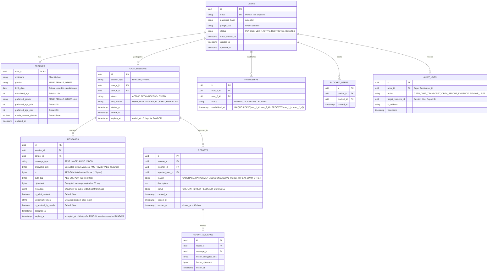
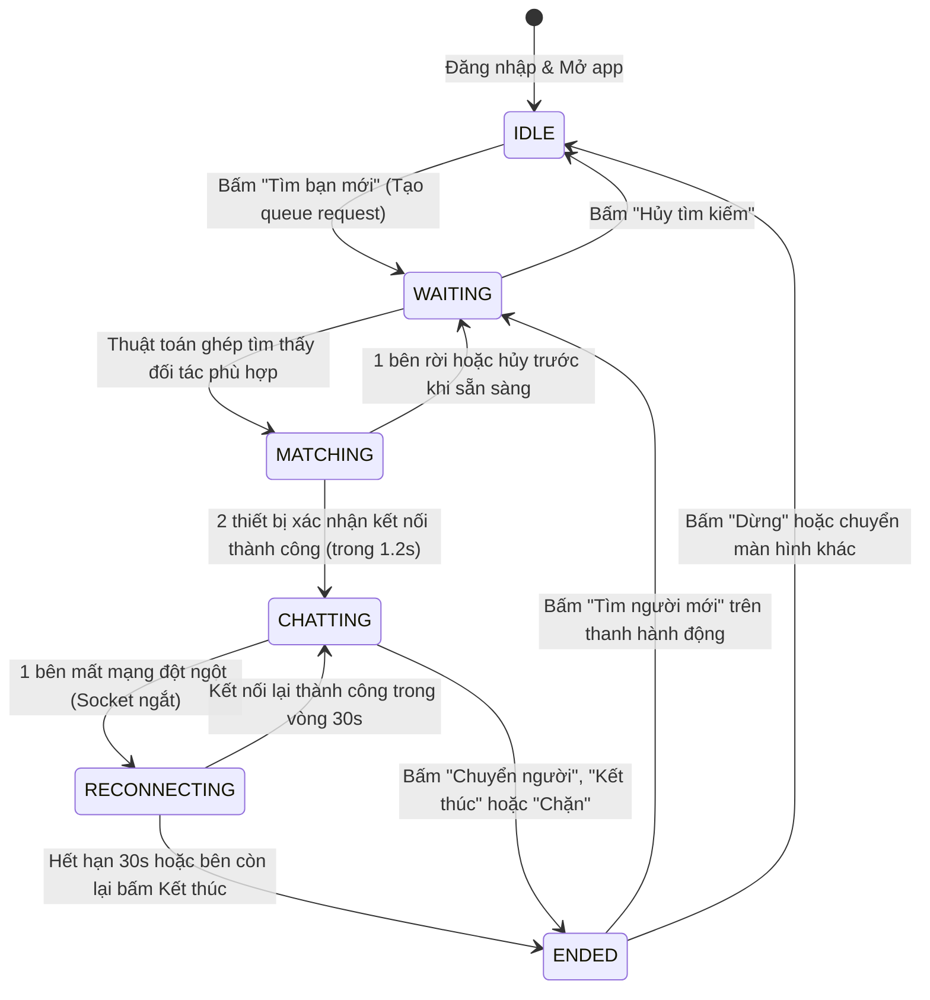

# Mô hình Dữ liệu Nghiệp vụ (Data Model Specification)

**Dự án**: Chatible — Fullstack Web & Mobile App  
**Cơ sở Dữ liệu**: PostgreSQL 16 + Redis 7  
**Tài liệu tham chiếu**: `docs/dac-ta-nghiep-vu-v1.1.md` (Mục 15, 26)  

---

## 1. Sơ đồ Thực thể Quan hệ (Entity-Relationship Diagram)

---

## 2. Chi tiết Bảng & Ràng buộc PostgreSQL

### Bảng `users` & `profiles`
- Ràng buộc: `calculated_age >= 18` (bắt buộc theo Hiến pháp).
- Ràng buộc: `birth_date <= CURRENT_DATE - INTERVAL '18 years'`.
- Cột sinh tự động: `calculated_age INT GENERATED ALWAYS AS (DATE_PART('year', AGE(birth_date))) STORED;` (tránh sai lệch khi qua sinh nhật).
- Chỉ số (Indexes):
  - `idx_users_email` (UNIQUE, WHERE deleted_at IS NULL).
  - `idx_profiles_gender_age` (Hỗ trợ matching query).

### Bảng `messages` (Envelope Encryption Storage)
- **Cột bảo mật**:
  - `encrypted_dek`: Chứa DEK đã được Local KMS Provider bọc bằng Master KEK (AES-KeyWrap). Không thể đọc được nội dung nếu không có KEK.
  - `iv`: Vector khởi tạo 96-bit (12 bytes) ngẫu nhiên cho mỗi tin nhắn.
  - `auth_tag`: Thẻ xác thực toàn vẹn 128-bit (16 bytes).
  - `ciphertext`: Dữ liệu nội dung sau khi mã hóa bằng AES-256-GCM.
- **Chỉ số (Indexes)**:
  - `idx_messages_session_accepted` (`session_id`, `accepted_at`).
  - `idx_messages_expires_at` (`expires_at`) — Phục vụ cron job dọn dẹp tin nhắn hết hạn.

---

## 3. Cấu trúc Khóa Redis 7 (Matching Queue & Cache)

| Redis Key Pattern | Kiểu Dữ liệu | Mục đích sử dụng | TTL / Expiry |
|---|---|---|---|
| `match:queue:<target_gender>:<self_gender>` | **ZSET** | Hàng chờ ghép đôi. Member: `user_id`, Score: `timestamp` vào hàng. | Tự xóa khi match hoặc hủy |
| `match:user:<user_id>` | **HASH** | Lưu tiêu chí lọc: `age`, `age_min`, `age_max`, `socket_id`, `last_partner_id`. | 10 phút |
| `match:reserved:<user_id>` | **STRING** | Khóa tạm thời người dùng khi tìm thấy cặp hợp lệ (tránh 2 server cùng ghép). | 10 giây |
| `session:active:<user_id>` | **STRING** | Trạng thái phiên hiện tại của user (`IDLE`, `WAITING`, `CHATTING:session_id`). | Theo phiên |
| `session:reconnect:<session_id>` | **STRING** | Đếm ngược 30 giây khi 1 bên rớt mạng. | 30 giây |
| `token:media:<token_id>` | **STRING** | Token mờ hạn ngắn để xem ảnh/video người lớn (chứa `s3_key`). | 5 phút (300s) |

---

## 4. Máy trạng thái Vòng đời Chat (State Machine)

